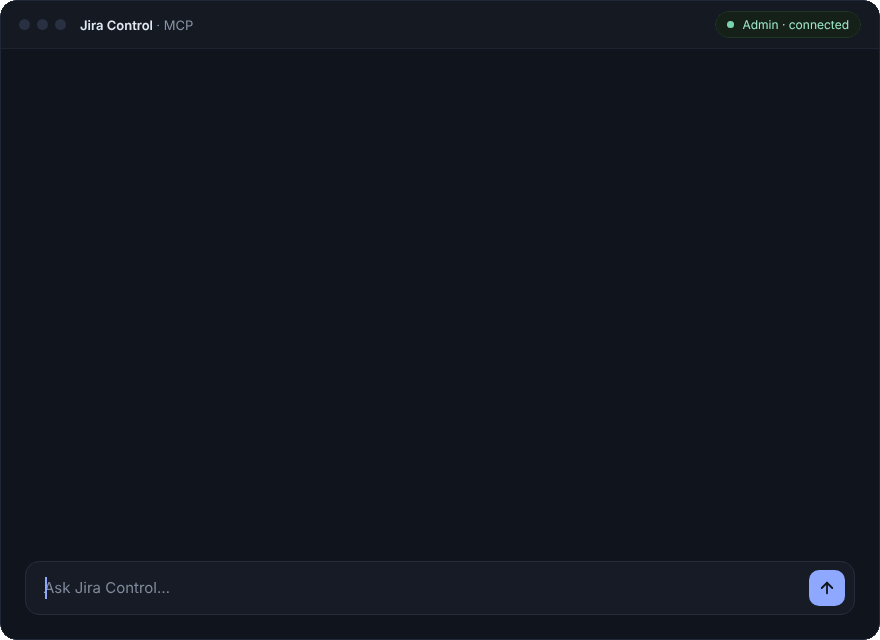
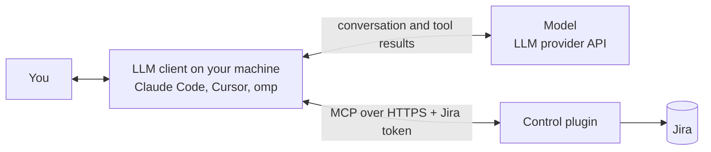

# Control: an MCP server for administering Jira through LLM chat

English | [Русский](README.ru.md)

A plugin for Jira 10.3 that is itself an MCP server. You write in plain words — "create a 'Customer priority' field for all projects", "give PAY its own copy of the shared workflows" — the model shows a plan of changes, you say "yes", and the plugin changes Jira. No client-side plugin is needed: a compatible MCP client is enough (see [Requirements](#requirements)).





The model only decides which tool to call; the client makes the call. The Jira token stays in the client, while tool results go to the LLM provider along with the conversation (see [Data and privacy](#data-and-privacy)).

## Why

- **Consequences before writing.** What is created, what changes, which other projects and how many issues are affected — before you say "yes".
- **Safe handling of shared configuration.** The plugin sees that a scheme, workflow or field context is shared and offers to give the project its own copy instead of changing it for everyone.
- **Stale plan check.** Before writing, the server re-reads the Jira state the plan depends on; if it changed since the preview, nothing is written.
- **Audit log.** The Audit page shows who applied what through the chat.

## Requirements

- Jira 10.3.x, Java 17. Tested on single-node Jira; Jira 9 and clustered Data Center have not been tested.
- A Jira administrator account with Personal Access Tokens enabled.
- An MCP client with Streamable HTTP transport and custom headers (Claude Code, Cursor, VS Code, omp; Claude Desktop via `mcp-remote`).
- Optional: ScriptRunner for Jira — for validators and the project role condition; Jira Service Management with Assets — for Assets fields.

The user-facing texts are in Russian: tool titles shown by the client and parts of the preview texts. Tool descriptions and model rules are in English.

## Quick start

> Start with a staging Jira. The plugin changes live configuration and there is no undo.

1. **Install the plugin.** Get the JAR from [Releases](https://github.com/Italia1235/control/releases) or build it (requires the Atlassian SDK, see [For developers](#for-developers)): `atlas-mvn package` → `target/control-<version>.jar`. In Jira: Administration → Manage apps → Upload app.
2. **Create a token.** Administrator profile → Personal Access Tokens → Create token. Set an expiry date.
3. **Connect your client** (below).
4. **Check:** ask "which workflows does project X use?" — this only reads.

MCP endpoint: `<Jira base URL>/rest/control/1.0/mcp`, including the context path (for example `https://jira.example.com/rest/control/1.0/mcp`, or locally `http://localhost:2990/jira/rest/control/1.0/mcp`). Only `Authorization: Bearer <PAT>` is accepted: browser cookies and Basic auth get 401, a foreign `Origin` gets 403.

## Connecting a client

In the Claude Code and omp examples the token comes from the `JIRA_PAT` environment variable: the config stores the reference `${JIRA_PAT}`, not the token itself. Claude Desktop is the exception (below).

**Claude Code.** In bash, zsh and PowerShell put the header in single quotes; otherwise the shell substitutes the token and it is saved in plain text in `~/.claude.json`. In Windows `cmd.exe` use double quotes: `${…}` is not expanded there.

```
claude mcp add --scope user --transport http jira-control https://jira.example.com/rest/control/1.0/mcp --header 'Authorization: Bearer ${JIRA_PAT}'
```

Do not add the server with a token using `--scope project`: `.mcp.json` is usually committed.

**omp** — `~/.omp/agent/mcp.json`, then `/mcp list`:

```json
{
  "mcpServers": {
    "jira-control": {
      "type": "http",
      "url": "https://jira.example.com/rest/control/1.0/mcp",
      "headers": { "Authorization": "Bearer ${JIRA_PAT}" }
    }
  }
}
```

**Cursor, VS Code and others** — same URL and header; check your client's docs for environment variable syntax.

**Claude Desktop** only launches local programs, so it needs the `mcp-remote` proxy (requires Node.js). Here the token sits in `claude_desktop_config.json` in plain text: `env` only keeps it out of the command line, it does not make the file a secret store. Restrict access to the file with OS permissions and use a short-lived token; if that is not acceptable, pick a client that supports variables in headers.

```json
{
  "mcpServers": {
    "jira-control": {
      "command": "npx",
      "args": ["mcp-remote", "https://jira.example.com/rest/control/1.0/mcp", "--header", "Authorization:${JIRA_AUTH}"],
      "env": { "JIRA_AUTH": "Bearer <token>" }
    }
  }
}
```

The Claude.ai and ChatGPT web connectors will not work: they need a public URL with OAuth.

**Long operations.** An apply runs in the background on the server: `start_operation` returns an `operationId` right away, and a dropped connection or a closed client does not stop the operation. Progress and outcome are read with `get_operation` by that `operationId`, including after reconnecting. If the `start_operation` response is lost, repeat the identical call with the same `planId`: the server returns the operation already started (`alreadyStarted:true`) instead of creating a new one.

### Token security

- The token grants full administrator access. For a remote Jira use `https://` only: over HTTP the token travels in plain text.
- Set `JIRA_PAT` for the session before starting the client, from a secret manager (Windows Credential Manager, macOS Keychain, `pass`, 1Password CLI). `setx` or an `export` in your shell profile is simpler, but then every process you run can read the token — including an agent with shell access, which may print it into the conversation.
- Consider a dedicated administrator account for Control: Audit and Jira history then show that a change came from the chat.
- If the token may have leaked, revoke it: profile → Personal Access Tokens.

## What you can ask for

Example requests; all 47 tools are listed in [TOOLS.md](TOOLS.md).

| Area | Examples |
| --- | --- |
| Projects | "Create project POPS from the Kanban template, lead alex" · "Keep only issue types A, B, C in the project" |
| Issue types and resolutions | "Create issue types Order, Request, Consultation" · "Create resolution 'Order fulfilled'" |
| Custom fields | "Create three fields: text, multi-select and Assets" · "Add an option to the list" |
| Screens | "Add fields A and B to screens X and Y" · "Put Severity after Assignee" · "Remove the field from the create screen" |
| Screen schemes | "Use screen X for create in PAY" · "Let PAY use the ABC screen scheme" · "Give PAY its own copy of the shared screens" |
| Required fields and field configurations | "Make Severity required in PAY" · "Give PAY its own field configuration" |
| Workflows | "Create a workflow from this diagram (or photo)" · "Assign it to the project" · "Give PAY its own copy of the shared workflows" · "Require a comment on the Done transition" |
| Statuses | "Rename a status / change its category" |
| Reading | "Which screens and workflows does PAY use?" |

## How changes work

1. **Preview.** The model calls a tool with `dryRun:true`. Jira is not changed; the server returns a plan and a one-time `planId` (valid for 10 minutes).
2. **Confirmation.** The model shows the plan, you answer "yes".
3. **Apply.** The model calls `start_operation` with the `planId` and follows the result with `get_operation`. The server rebuilds the plan under a lock and writes only if the Jira state the plan depends on (captured in the plan's fingerprint) has not changed since the preview. Otherwise it returns `PREVIEW_STALE`: a new preview and a new "yes" are needed. The lock orders only Control operations: a change made through the Jira UI, REST or another plugin after this check but before the write is not detected.

**Who checks what.** These are three different mechanisms:

- **Your "yes" to the plan.** The model must show the preview and wait for your consent; the rules the server sends in MCP `instructions` require it. This is model behavior, not a technical guarantee.
- **The client's permission to call a tool.** Many clients ask before calling a tool. This is an extra barrier: do not enable auto-approval for this server, so the model cannot apply a plan behind your back. But even with the permission prompt on, the model may skip asking "yes" to the plan — these are separate questions.
- **The server.** It cannot check that a human agreed. It checks something else: the plan has not expired, belongs to the same administrator, and the Jira state the plan depends on has not changed since the preview; otherwise `PREVIEW_STALE`.

The scenarios in `evals/live` were run mainly with Claude Sonnet 5.5 and GPT-6.1; weaker models may break the protocol.

A current plan does not guarantee a successful apply. `FAILED`, `PARTIAL` and `UNKNOWN` are not success: Jira may have changed partially, and there is no automatic rollback. Retry and recovery protocol: [TOOLS.md](TOOLS.md#operations-and-recovery-protocol).

## Data and privacy

- Tool results enter the conversation and go to the model provider: names of projects, fields, schemes, workflows and statuses, user names (for example, project leads) and issue counts. The plugin does not read issue content (summary, description, comments).
- To keep data in-house, use a model hosted inside your own perimeter. For an external provider, including a corporate cloud one, check its data processing and retention terms.
- The plugin itself calls no external services.

## Audit log

Manage apps → Control → **Audit** (`/plugins/servlet/control/applies`, administrators only): who applied which change, when, through which tool, and with what result. Previews and reads are not logged. The log is not complete: a missing row does not prove that nothing changed. Details: [howitworks/audit](howitworks/audit/Audit-how-it-works.md).

## Limitations

- **No undo.** Created objects are removed by hand; the `report` block of the result lists what was created and what was reused. The "Rollback requested" field in Audit belongs to an internal rollback mechanism that is not available through MCP.
- **Shared schemes.** Changing a shared scheme, workflow or context affects every project that uses it. The preview names those projects; to change one project only, first give it its own copy (`clone_project_*`).
- **Global objects.** Issue types, statuses and resolutions are global: a change is visible to every project.
- **Workflow rules** — only the supported ones: required fields, comment, group condition (built into Jira) and project role condition, resolution (built-in post functions). Validators and the role condition require ScriptRunner. Arbitrary scripts and post functions are not supported. An active workflow is changed through a draft; publishing is a separate step.
- **Assets** — only the Assets object field type; requires Jira Service Management and at least one object schema.
- **Plugin storage** (Active Objects) has not been tested on Oracle, SQL Server or MySQL.
- **Do not upgrade the plugin while operations are running.**

## Troubleshooting

| Symptom | Cause |
| --- | --- |
| 401 | No token, an expired token, or the client does not see `JIRA_PAT` — set the variable and restart the client. |
| 403 | The token owner is not a Jira administrator, or the request came from a foreign `Origin`. |
| 404 | Wrong URL (check the context path, e.g. `/jira`) or the plugin is disabled. |
| 409 | The same object is already being changed, or the operation queue is full; nothing was started. Wait and repeat the same call. |
| `PREVIEW_STALE` | The Jira state the plan depends on changed, or the plan expired (10 minutes). A new preview and a new "yes" are needed, not a retry. |
| The model does not ask for confirmation | The client does not pass the server's `instructions` to the model. Paste [`rules.md`](src/main/resources/llm/rules.md) into the client's rules and do not enable auto-approval for this server. |
| Tools behave the old way | The new JAR is not installed, or the client cached the tool list: reconnect the MCP server. |

## For developers

- Java 17, Atlassian SDK 9.1.1, Node.js 20.6+ for evals (`--env-file`). `atlas-run` starts Jira 10.3 with the plugin and JSM at `http://localhost:2990/jira` (admin/admin). The first run needs network access (repositories in `.mvn/settings.xml`); afterwards `atlas-run -o` works offline.
- `atlas-mvn test` runs the unit tests. To check a built JAR: `atlas-mvn -o -q test -Dtest=PluginPackagingTest -Dcontrol.packagedJar=target/control-<version>.jar`.
- GitHub Actions builds and checks the installable plugin JAR, then publishes it as the `control-jar` workflow artifact; the separate `-tests.jar` is excluded.
- Wired tests run only against a disposable Jira: `-Dcontrol.wired.tests.enabled=true` on the Jira JVM, then `atlas-mvn com.atlassian.maven.plugins:jira-maven-plugin:9.1.1:remote-test -Dserver=localhost -Dhttp.port=2990 -Dcontext.path=/jira`.
- Model behavior is checked by [evals/offline](evals/offline/README.md) (free, deterministic) and [evals/live](evals/live/README.md) (LLM-to-LLM dialogues against a running Jira, paid).
- Tool descriptions and model rules: `src/main/resources/llm/`. Clients receive them on connect, after the JAR is rebuilt and uploaded.
- Internals: [howitworks/](howitworks/). Release history: [Versions.md](Versions.md).

## License

[Business Source License 1.1](LICENSE) (`BUSL-1.1`): source-available, not open source.

- Testing, development, staging and evaluation environments are free.
- Production use is free in a Jira instance with no more than 50 active users. For larger instances, contact the author.
- Each version converts to the Apache License 2.0 four years after its release.

Third-party libraries: [THIRD-PARTY-NOTICES.md](THIRD-PARTY-NOTICES.md).

## Contact

- Bugs and questions: [GitHub Issues](https://github.com/Italia1235/control/issues).
- Vulnerabilities: [SECURITY.md](SECURITY.md).
- Author: Telegram [@Italia1235](https://t.me/Italia1235), rasulovrus228@gmail.com.
