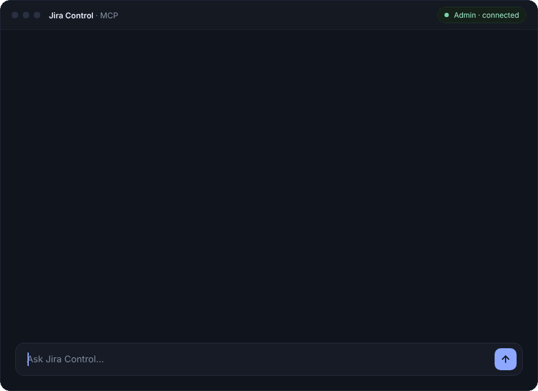
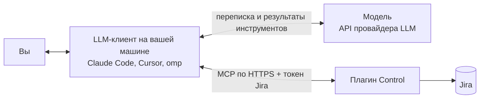

# Control: MCP-сервер для администрирования Jira через чат с LLM

[English](README.md) | Русский

Плагин для Jira 10.3, который сам является MCP-сервером. Вы пишете в чате обычными словами — «создай поле "Приоритет клиента" для всех проектов», «отдели PAY от общих workflow», — модель показывает план изменений, вы отвечаете «да», плагин меняет Jira. Отдельный плагин для клиента не нужен: подойдёт совместимый MCP-клиент (см. [Требования](#требования)).





Модель только решает, какой инструмент вызвать; вызывает его клиент. Токен Jira хранится в клиенте, а ответы инструментов уходят провайдеру LLM вместе с перепиской (см. [Данные и приватность](#данные-и-приватность)).

## Зачем

- **Превью последствий до записи.** Что создаётся, что меняется, какие ещё проекты и сколько задач это заденет — до того, как вы ответите «да».
- **Безопасная работа с общими настройками.** Плагин видит, что схема, workflow или контекст поля общие, и предлагает сначала отделить проект, а не менять всем.
- **Защита от устаревшего плана.** Перед записью сервер перечитывает состояние Jira, от которого зависит план; если оно изменилось с момента превью, запись не выполняется.
- **Журнал.** Страница Audit показывает, кто и что применил через чат.

## Требования

- Jira 10.3.x, Java 17. Проверено на одноузловой Jira; Jira 9 и кластер Data Center не проверялись.
- Учётная запись администратора Jira и включённые Personal Access Tokens.
- MCP-клиент с транспортом Streamable HTTP и заголовками (Claude Code, Cursor, VS Code, omp; Claude Desktop — через `mcp-remote`).
- Необязательно: ScriptRunner for Jira — для валидаторов и условия по проектной роли; Jira Service Management с Assets — для полей Assets.

Интерфейс инструментов на русском: заголовки инструментов в клиенте и часть текстов превью — по-русски. Описания инструментов и правила для модели — на английском.

## Быстрый старт

> Начните с тестовой Jira (staging). Плагин меняет живую конфигурацию, а отката нет.

1. **Установите плагин.** JAR из [Releases](https://github.com/Italia1235/control/releases) или соберите сами (нужен Atlassian SDK, см. [Для разработчиков](#для-разработчиков)): `atlas-mvn package` → `target/control-<версия>.jar`. В Jira: Administration → Manage apps → Upload app.
2. **Создайте токен.** Профиль администратора → Personal Access Tokens → Create token. Укажите срок действия.
3. **Подключите клиент** (ниже).
4. **Проверьте:** спросите «какие workflow у проекта X?» — это только чтение.

Адрес MCP: `<базовый URL Jira>/rest/control/1.0/mcp`, context path входит в адрес (например, `https://jira.example.com/rest/control/1.0/mcp` или локально `http://localhost:2990/jira/rest/control/1.0/mcp`). Принимается только `Authorization: Bearer <PAT>`: cookie браузера и Basic получают 401, чужой `Origin` — 403.

## Подключение клиента

В примерах для Claude Code и omp токен берётся из переменной окружения `JIRA_PAT`: в конфиг пишется ссылка `${JIRA_PAT}`, а не сам токен. Исключение — Claude Desktop (ниже).

**Claude Code.** В bash, zsh и PowerShell заголовок берите в одинарные кавычки, иначе оболочка подставит токен и он сохранится в `~/.claude.json` открытым текстом. В Windows `cmd.exe` используйте двойные кавычки: `${…}` там не раскрывается.

```
claude mcp add --scope user --transport http jira-control https://jira.example.com/rest/control/1.0/mcp --header 'Authorization: Bearer ${JIRA_PAT}'
```

Не добавляйте сервер с токеном через `--scope project`: `.mcp.json` обычно коммитят.

**omp** — `~/.omp/agent/mcp.json`, затем `/mcp list`:

```json
{
  "mcpServers": {
    "jira-control": {
      "type": "http",
      "url": "https://jira.example.com/rest/control/1.0/mcp",
      "headers": { "Authorization": "Bearer ${JIRA_PAT}" }
    }
  }
}
```

**Cursor, VS Code и другие** — тот же адрес и заголовок; синтаксис переменных окружения смотрите в документации клиента.

**Claude Desktop** запускает только локальные программы, поэтому нужен прокси `mcp-remote` (требует Node.js). Токен при этом лежит в `claude_desktop_config.json` открытым текстом: `env` только убирает его из аргументов командной строки, файл секретным хранилищем не становится. Ограничьте доступ к файлу правами ОС и используйте токен с коротким сроком действия; если это неприемлемо, выберите клиент с поддержкой переменных в заголовках.

```json
{
  "mcpServers": {
    "jira-control": {
      "command": "npx",
      "args": ["mcp-remote", "https://jira.example.com/rest/control/1.0/mcp", "--header", "Authorization:${JIRA_AUTH}"],
      "env": { "JIRA_AUTH": "Bearer <токен>" }
    }
  }
}
```

Веб-коннекторы Claude.ai и ChatGPT не подойдут: им нужен публичный адрес с OAuth.

**Долгие операции.** Применение выполняется в фоне на сервере: `start_operation` сразу возвращает `operationId`, а обрыв соединения или закрытие клиента операцию не останавливает. Ход и итог читаются через `get_operation` по этому `operationId`, в том числе после переподключения. Если ответ `start_operation` потерян, повторяется идентичный вызов с тем же `planId`: сервер вернёт уже запущенную операцию (`alreadyStarted:true`), а не создаст новую.

### Токен и безопасность

- Токен даёт полный доступ администратора. Для удалённой Jira используйте только `https://`: по HTTP токен уходит по сети открытым текстом.
- Задавайте `JIRA_PAT` на время сессии перед запуском клиента (из менеджера секретов: Windows Credential Manager, macOS Keychain, `pass`, 1Password CLI). `setx` или `export` в профиле шелла проще, но тогда токен видят все ваши процессы — в том числе агент с доступом к shell, который может вывести его в переписку.
- Удобно завести отдельную учётную запись администратора для Control: в Audit и истории Jira будет видно, что изменение сделано через чат.
- При подозрении на утечку отзовите токен: профиль → Personal Access Tokens.

## Что можно попросить

Примеры запросов; полный список из 47 инструментов — в [TOOLS.ru.md](TOOLS.ru.md).

| Область | Примеры |
| --- | --- |
| Проекты | «Создай проект POPS по шаблону Kanban, руководитель alex» · «Оставь в проекте только типы A, B, C» |
| Типы задач и Resolution | «Создай типы Заказ, Заявка, Консультация» · «Создай результат "Заказ исполнен"» |
| Кастомные поля | «Создай три поля: текст, список с множественным выбором и Assets» · «Добавь опцию в список» |
| Экраны | «Добавь поля A и B на экраны X и Y» · «Поставь Severity после Исполнителя» · «Убери поле с экрана создания» |
| Схемы экранов | «Назначь экран X на создание в PAY» · «Пусть PAY использует схему экранов ABC» · «Отдели экраны PAY от общих» |
| Обязательность и конфигурации полей | «Сделай Severity обязательным в PAY» · «Отдели PAY от общей конфигурации полей» |
| Workflow | «Создай workflow по этой схеме (или фото)» · «Подключи его к проекту» · «Отдели PAY от общих workflow» · «Требуй комментарий на переходе Done» |
| Статусы | «Переименуй статус / смени категорию» |
| Чтение | «Какие экраны и workflow у проекта PAY?» |

## Как работают изменения

1. **Превью.** Модель вызывает инструмент с `dryRun:true`. Jira не меняется; сервер возвращает план и одноразовый `planId` (живёт 10 минут).
2. **Подтверждение.** Модель показывает план, вы отвечаете «да».
3. **Применение.** Модель вызывает `start_operation` с `planId` и следит за результатом через `get_operation`. Сервер заново строит план под блокировкой и пишет, только если состояние Jira, от которого зависит план (оно зафиксировано в fingerprint плана), не изменилось с момента превью. Иначе — `PREVIEW_STALE`: нужны новое превью и новое «да». Блокировка упорядочивает только операции Control: изменение через интерфейс Jira, REST или другой плагин, сделанное после этой проверки, но до записи, не обнаруживается.

**Кто что проверяет.** Это три разных механизма:

- **Ваше «да» плану.** Модель обязана показать превью и дождаться вашего согласия; этого требуют правила, которые сервер передаёт в MCP `instructions`. Это поведение модели, а не техническая гарантия.
- **Разрешение клиента на вызов инструмента.** Многие клиенты спрашивают, можно ли вызвать инструмент. Это дополнительный барьер: не включайте для этого сервера автоодобрение, тогда модель не сможет применить план в обход вас. Но и с включённым запросом разрешения модель может не спросить «да» плану — это разные вопросы.
- **Сервер.** Не может проверить, что человек согласился. Он проверяет другое: план не истёк, принадлежит тому же администратору и состояние Jira, от которого зависит план, не изменилось с превью; иначе `PREVIEW_STALE`.

Сценарии в `evals/live` прогонялись в основном на Claude Sonnet 5.5 и GPT-6.1; с более слабыми моделями протокол может нарушаться.

Актуальность плана не гарантирует успешного применения. Результаты `FAILED`, `PARTIAL` и `UNKNOWN` — не успех: Jira могла измениться частично, автоматического отката нет. Протокол повторов и восстановления: [TOOLS.ru.md](TOOLS.ru.md#протокол-операций-и-восстановления).

## Данные и приватность

- Ответы инструментов попадают в переписку и уходят провайдеру модели: названия проектов, полей, схем, workflow, статусов, имена пользователей (например, руководителей проектов) и число задач. Тексты задач (summary, описание, комментарии) плагин не читает.
- Чтобы данные не покидали контур, используйте модель, размещённую внутри вашего контура. Для внешнего провайдера, в том числе корпоративного облачного, проверьте его условия обработки и хранения данных.
- Плагин сам не обращается ни к каким внешним сервисам.

## Журнал Audit

Manage apps → Control → **Audit** (`/plugins/servlet/control/applies`, только администраторы): кто, когда и через какой инструмент применил изменение и с каким результатом. Превью и чтения не записываются. Журнал не полный — отсутствие строки не доказывает, что изменения не было. Подробно (на английском): [howitworks/audit](howitworks/audit/Audit-how-it-works.md).

## Ограничения

- **Отката нет.** Созданное удаляется вручную; что создано, а что переиспользовано, видно в блоке `report` результата. Поле «Rollback requested» в Audit относится к внутреннему механизму отката, который через MCP недоступен.
- **Общие схемы.** Изменение общей схемы, workflow или контекста затрагивает все проекты, которые их используют. Превью называет эти проекты; чтобы изменить только один проект, его сначала отделяют (`clone_project_*`).
- **Глобальные объекты.** Типы задач, статусы и Resolution — глобальные: изменение видно всем проектам.
- **Правила workflow** — только поддерживаемые: обязательные поля, комментарий, условие по группе (штатное Jira) и по проектной роли, Resolution (штатные post-function). Валидаторы и условие по роли требуют ScriptRunner. Произвольные скрипты и пост-функции не поддерживаются. Активный workflow меняется через draft, публикация — отдельный шаг.
- **Assets** — только тип Assets object; нужны Jira Service Management и хотя бы одна схема объектов.
- **Хранилище плагина** (Active Objects) на Oracle, SQL Server и MySQL не проверялось.
- **Не обновляйте плагин, пока идут операции.**

## Если что-то не работает

| Симптом | Причина |
| --- | --- |
| 401 | Токена нет, он истёк, или клиент не видит `JIRA_PAT` — задайте переменную и перезапустите клиент. |
| 403 | Владелец токена не администратор, или запрос пришёл с чужим `Origin`. |
| 404 | Неверный адрес (проверьте context path, например `/jira`) или плагин выключен. |
| 409 | Тот же объект уже меняется или очередь операций полна, ничего не запущено. Подождите и повторите тот же вызов. |
| `PREVIEW_STALE` | Изменилось состояние Jira, от которого зависит план, или план истёк (10 минут). Нужны новое превью и новое «да», не повтор. |
| Модель не спрашивает подтверждения | Клиент не передаёт модели `instructions` сервера. Вставьте [`rules.md`](src/main/resources/llm/rules.md) в правила клиента и не включайте автоодобрение вызовов этого сервера. |
| Старое поведение инструментов | Не загружен новый JAR или клиент закешировал каталог: переподключите MCP-сервер. |

## Для разработчиков

- Java 17, Atlassian SDK 9.1.1, Node.js 20.6+ для эвалов (`--env-file`). `atlas-run` поднимает Jira 10.3 с плагином и JSM на `http://localhost:2990/jira` (admin/admin). Первый запуск требует сети (репозитории в `.mvn/settings.xml`), дальше можно `atlas-run -o`.
- `atlas-mvn test` — модульные тесты. Проверка собранного JAR: `atlas-mvn -o -q test -Dtest=PluginPackagingTest -Dcontrol.packagedJar=target/control-<версия>.jar`.
- GitHub Actions собирает и проверяет устанавливаемый JAR плагина, затем сохраняет его как артефакт запуска `control-jar`; отдельный `-tests.jar` исключён.
- Wired-тесты — только на одноразовой Jira: `-Dcontrol.wired.tests.enabled=true` на JVM Jira, затем `atlas-mvn com.atlassian.maven.plugins:jira-maven-plugin:9.1.1:remote-test -Dserver=localhost -Dhttp.port=2990 -Dcontext.path=/jira`.
- Поведение модели проверяют [evals/offline](evals/offline/README.md) (бесплатные детерминированные сценарии) и [evals/live](evals/live/README.md) (диалоги LLM с LLM на живой Jira, платные).
- Описания инструментов и правила для модели: `src/main/resources/llm/`. Клиент получает их при подключении, после пересборки и загрузки JAR.
- Как устроено внутри (на английском): [howitworks/](howitworks/). История версий (на английском): [Versions.md](Versions.md).

## Лицензия

[Business Source License 1.1](LICENSE) (`BUSL-1.1`), перевод: [LICENSE.ru.md](LICENSE.ru.md); юридическую силу имеет английский текст. Код открыт для чтения (source-available), но это не open source.

- Тестовые среды, среды разработки, staging и оценки — бесплатно.
- Production в Jira, где не больше 50 активных пользователей, — бесплатно. Для более крупных инстансов напишите автору.
- Каждая версия через 4 года после выхода переходит под Apache License 2.0.

Сторонние библиотеки: [THIRD-PARTY-NOTICES.md](THIRD-PARTY-NOTICES.md).

## Контакты

- Ошибки и вопросы: [GitHub Issues](https://github.com/Italia1235/control/issues).
- Уязвимости: [SECURITY.md](SECURITY.md).
- Автор: Telegram [@Italia1235](https://t.me/Italia1235), rasulovrus228@gmail.com.
