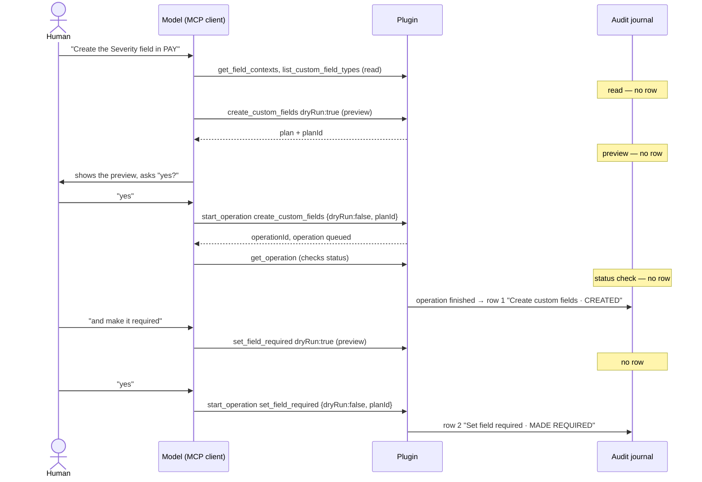
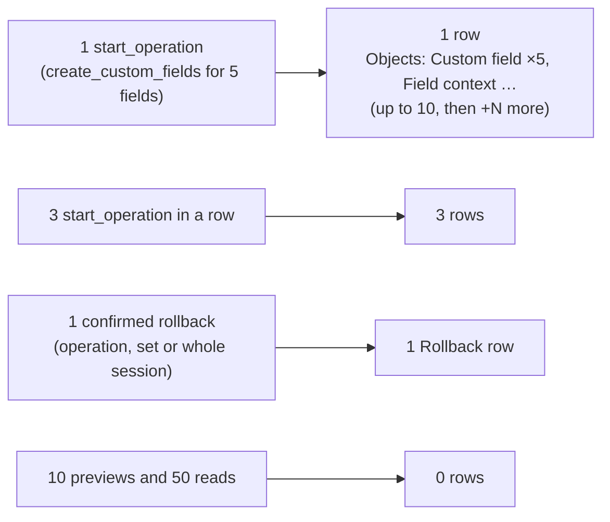
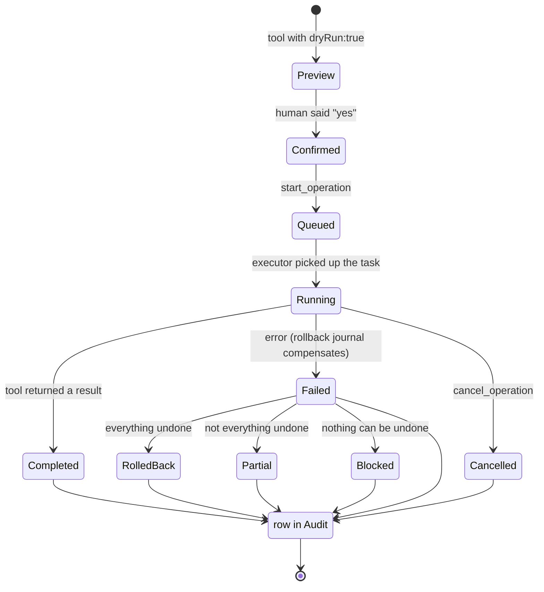
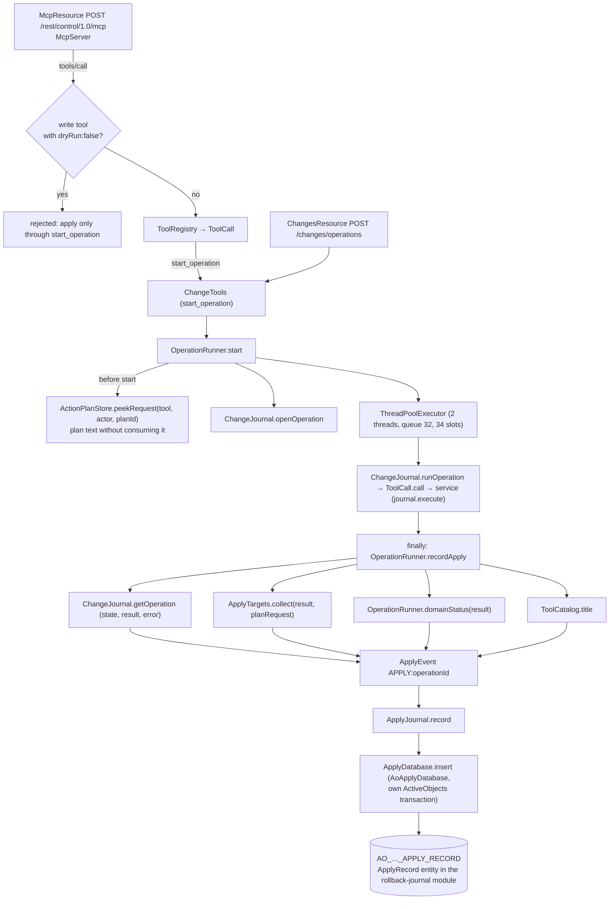
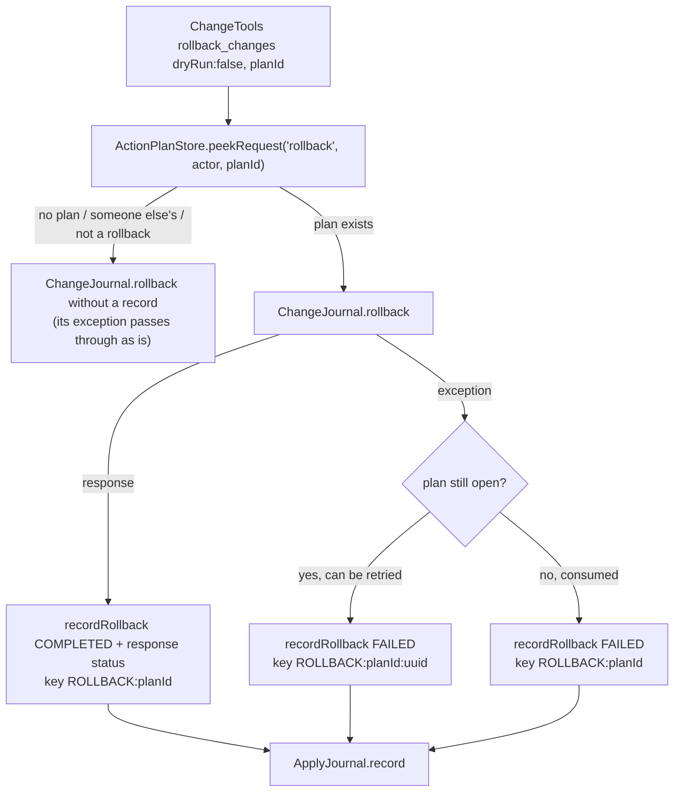

# How the Audit journal works

## In short

- A row in the journal = **one apply of a change** through the plugin: one confirmed `start_operation` or one confirmed rollback.
- One chat with the model can produce **any number of rows**: one per apply. A chat in which nothing was applied produces none.
- **Reads, previews, model questions, operation status checks and cancellation are not recorded.**
- One apply that touched many objects (for example, created 5 fields) is **one** row; the objects are listed in it (up to 10, then "+N more").
- The row appears **when the apply has finished**, not when it started.
- The journal is "best effort": if the write fails, the apply still goes through, but there is no row (an ERROR remains in the Jira log).

## What the administrator sees

Each row answers the questions: **when** (finish time), **who** (the Jira user on whose behalf the chat worked), **what** (the action, for example Create workflow), **on what** (objects: Project SHAVZ, Status "In Review"), **how it ended** (the Result badge). Expanding a row shows the details: links to the objects in Jira administration, raw codes, the error text, the operation ID.

The journal does not know or store which chat or which model did it: it sees only the Jira user whose token the MCP client used.

## One chat: what gets into the journal

A typical conversation "create a field and make it required in the project":

Result: one chat → **two** rows, because there were two confirmed applies.

## What is recorded and what is not

| What the chat did | Row in Audit |
|---|---|
| Read (`get_*`, `list_*`, `plan_field_screens`, etc.) | no |
| Preview of any tool (`dryRun:true`) | no |
| Confirmed apply (`start_operation`) | **yes, one** |
| Apply with a stale or someone else's preview | **yes**: the tool returned `PREVIEW_STALE`, row "Preview expired" |
| Apply failed | **yes**: "Failed", "Failed, undone", "Partly undone", etc. |
| Status check (`get_operation`) | no |
| Cancellation (`cancel_operation`) | no new row; the outcome is visible in the row of that apply (Cancelled / rollback) |
| Sessions and change sets (`create_change_session`, `begin_change_set`, `finish_change_set`, `list_*`) | no |
| Rollback preview (`rollback_changes` with `dryRun:true`) | no |
| Confirmed rollback (`rollback_changes` with `dryRun:false` and `planId`) | **yes, one** (Rollback event) |
| Rollback with an unknown, someone else's or non-rollback `planId` | no (this is not an apply) |
| Manual edits in the Jira UI, other plugins | no: the journal sees only applies through this plugin |

## How many rows one action produces

Repeating the same record (the same `operationId` or the same rollback plan) does not create a second row. Exception: a rollback that failed while its preview stayed open (for example, the lock was taken) can be retried with the same `planId`; then the failed attempt and the successful one are two separate rows.

## Lifecycle of one apply

While the operation is queued or running, there is no row. If the plugin was upgraded or a Jira node went down in the middle of an operation, the row will not appear at all (pilot rule: do not upgrade the plugin while operations are running).

## How to read the Result badge

| Badge | Color | Meaning |
|---|---|---|
| CREATED, ADDED | green | something new was created |
| CHANGED, ASSIGNED, MOVED, REMOVED, PUBLISHED, ROLLED BACK | blue | something existing was changed |
| MADE REQUIRED, MADE OPTIONAL | orange | a field's required flag was changed |
| CLONED | purple | a copy was made |
| ALREADY EXISTED, NO CHANGES, ALREADY …, MIXED, DONE | gray | Jira was already like that, or the outcome is mixed; details in the row |
| PREVIEW EXPIRED, PARTLY DONE, CANCELLED, PARTLY UNDONE | yellow | check it: not everything was applied, or nothing was |
| FAILED, … CONFLICT, JIRA ERROR, ROLLBACK BLOCKED | red | error or conflict |

`DONE` on old `create_custom_fields` rows (before 23.10.2026 ~16:10): back then the journal could not aggregate a common status across fields. New rows get `CREATED` or `MIXED`.

A row is the fact "an apply was started through the plugin and this is how it ended", not proof that Jira changed: `ALREADY EXISTED` and `NO CHANGES` mean that nothing was changed.

---

## Technical part

### Write path (APPLY)

- `McpServer` does not allow calling a write tool directly with `dryRun:false`. There are no direct REST endpoints for tools anymore (removed 23.10.2026), so the only apply path is `start_operation` (MCP or `POST /rest/control/1.0/changes/operations`), and `OperationRunner` sees every apply.
- `OperationRunner.peekPlan` reads the plan text **before** the start: the tool consumes the plan on apply. The operation (= tool name), the actor and the expiry are checked.
- `OperationRunner.recordApply` is called in the `finally` of the executor task and on the path where the executor rejected the task. It never throws (except `VirtualMachineError`): a journal error does not change the operation, its result or the release of the slot.
- `ApplyTargets.collect`: first the result's `report.created[]` (type, name, id, link), then known top-level keys of the plan request (`project`, `fields`, `screenId`, `name`, …); a target from the request is dropped if the report already named the same object by name or id; up to 10 targets, the rest is `more`.
- `OperationRunner.domainStatus`: the result's `status`; if it is absent but `results[].status` exists (as with `create_custom_fields`), the common status of the items or `MIXED`.
- `ApplyJournal.record`: checks required fields and allowed `EVENT_TYPE`/`OPERATION_STATE`, truncates lengths, writes one row. A uniqueness violation on `EVENT_KEY` is a repeat: the row already exists, no error. Any other error is an ERROR in the log, and no row is written.

### Write path (ROLLBACK)

### Read path (page)

```mermaid
flowchart LR
    MENU["Manage apps → Control → Audit<br/>web-section/web-item, UserIsAdminCondition"] --> SRV["AppliesAdminServlet<br/>/plugins/servlet/control/applies<br/>admin + WebSudo"]
    SRV -->|"applies.vm (atl.admin)<br/>data-base-url, data-context-path,<br/>data-i18n = control.applies.* via I18nResolver.getText"| JS["control.js + control.css<br/>(web-resource of the control context)"]
    JS -->|GET /applies/facets| RES["AppliesResource (admin)"]
    JS -->|"GET /applies?actor&tool&state&status&from&to&before&limit=30"| RES
    RES --> Q["ApplyQuery.parse (parameter check, 400 on error)"]
    Q --> RD["ApplyReader.list / facets"]
    RD --> DB2["ApplyDatabase.find / count / stream"]
    RD -->|"items, nextBefore (cursor by ID), total"| JS
```

- List: newest first by AO `ID`, 30 rows at a time, "Show more" continues with `before=nextBefore`; `total` is the number of rows for the same filters without the cursor.
- Facets (filter options): distinct values across the whole table, read as a stream; the page does not show a filter with only one option.
- Everything that comes from the journal is inserted only via `textContent`; a link is clickable only if it leads inside this Jira (base URL, http/https).

### Classes and files

| Class / file | Role |
|---|---|
| `common.impl.tools.McpServer` | MCP JSON-RPC; forbids direct apply with `dryRun:false` |
| `common.impl.tools.ChangeTools` | `start_operation`, `rollback_changes`, etc.; writes the rollback row (`applyRollback`, `recordRollback`) |
| `common.impl.tools.OperationRunner` | operation queue and executor; writes the apply row (`peekPlan`, `recordApply`, `domainStatus`) |
| `common.impl.tools.ToolCatalog` | tool catalog; `isDomainMutation`, `title` |
| `common.impl.ActionPlanStore` | previews (plans) in a replicated cache; `peekRequest` reads a plan without consuming it |
| `common.impl.undo.ChangeJournal` | rollback journal: operations, states, compensation, `rollback` (unchanged) |
| `common.impl.applies.ApplyEvent` | one event to record (raw values) |
| `common.impl.applies.ApplyTargets` | collects objects from the report and the plan request |
| `common.impl.applies.ApplyJournal` | the single write point: check, truncate, insert, duplicate = not an error |
| `common.impl.applies.ApplyRecord` | AO entity of a row (in the `rollback-journal` module) |
| `common.impl.applies.ApplyDatabase` / `AoApplyDatabase` | narrow AO access: `insert`, `exists`, `find`, `count`, `stream` |
| `common.impl.applies.ApplyQuery` | parses and checks `GET /applies` parameters |
| `common.impl.applies.ApplyReader` | reads the page and facets |
| `common.rest.AppliesResource` | `GET /rest/control/1.0/applies`, `/applies/facets` |
| `common.web.AppliesAdminServlet` + `templates/applies.vm` | page shell, texts, WebSudo |
| `resources/js/control.js`, `css/control.css`, `control.properties` | table, filters, badges, English texts |
| `atlassian-plugin.xml` | `<entity>ApplyRecord`, web-section/web-item, servlet, web-resource |

### Row fields (`ApplyRecord`)

| Column | Source |
|---|---|
| `EVENT_KEY` (unique) | `APPLY:<operationId>` or `ROLLBACK:<planId>[:uuid]` |
| `EVENT_TYPE` | `APPLY` / `ROLLBACK` |
| `RECORDED_AT` | operation finish time (for a rollback, the response time) |
| `ACTOR_KEY`, `ACTOR_NAME` | key and display name of the Jira user |
| `TOOL_NAME`, `TOOL_TITLE` | tool name and its title from the catalog (the page shows the English name from `control.properties`) |
| `OPERATION_REF` | operation ID (for a rollback, the scope ID) |
| `OPERATION_STATE` | `COMPLETED` / `FAILED` / `CANCELLED` / `ROLLED_BACK` / `PARTIAL` / `BLOCKED` |
| `DOMAIN_STATUS`, `ERROR_CODE`, `ERROR_MESSAGE` | what the tool answered / error text |
| `ROLLBACK_REQUESTED` | whether cancellation with rollback was requested |
| `TARGETS_JSON`, `LINKS_JSON` | objects (up to 10 + `more`) and admin links |

Rows are never changed or deleted by the plugin; there is no cleanup and no retention period.
