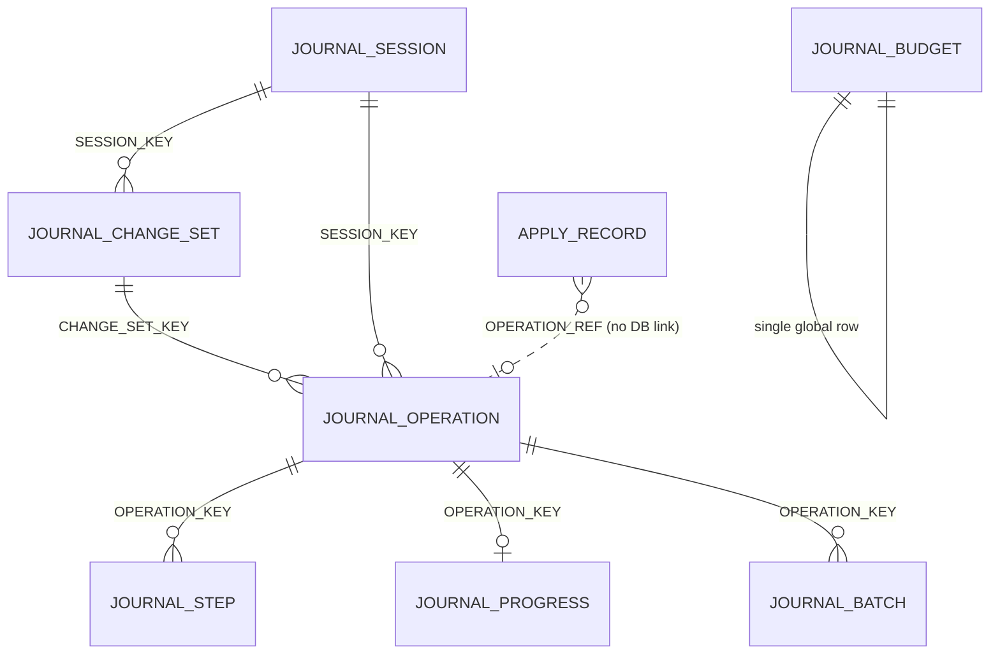
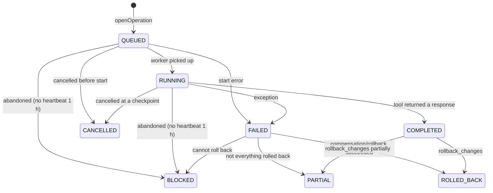

# Journal DB schema (Active Objects)

What the plugin stores in the Jira database: tables, columns, who writes what there and when it is deleted. State as of version 1.1.3. Later columns are not described here: `FIELD_CHANGES_JSON` in `APPLY_RECORD` (1.1.5), `EXECUTION_SLOT` and `PLAN_HASH` in the operation journal and the execution lock slots `ru.rasulov.control.undo.execution.0..255` (1.1.7) — see [Versions.md](../../Versions.md) and the entity sources.

Sources: AO module declaration `src/main/resources/atlassian-plugin.xml:23-32`, entities `src/main/java/ru/rasulov/common/impl/undo/Journal*.java` and `.../applies/ApplyRecord.java`, logic — `ChangeJournal`, `JournalStore`, `JournalCleanup`, `ApplyJournal`, `OperationRunner`, `ChangeTools`. How Audit works: [Audit-how-it-works](Audit-how-it-works.md).

## General

- **One AO module** `rollback-journal`, namespace `ru.rasulov.control.undo`. It has two independent parts:
  - **operation journal** (7 `JOURNAL_*` tables) — internal: operation queue and state, rollback data, progress, quota;
  - **Audit** (`APPLY_RECORD`) — apply history for the administrator. Not linked to the operation journal in the DB; it lives in the same module because a plugin can have only one AO configuration.
- **Table names.** AO adds the prefix `AO_` + the last 6 characters of the MD5 of the namespace: for `ru.rasulov.control.undo` this is `AO_3E3015` (computed by the AO rule, checked against the known Jira Software prefix `AO_60DB71`; verify on a live database). Table = interface name in UPPER_SNAKE: `AO_3E3015_JOURNAL_OPERATION`. Exception: `JournalProgressBatch` is declared as `@Table("JournalBatch")` → `AO_3E3015_JOURNAL_BATCH`.
- **Columns** — getter name in UPPER_SNAKE (`getSessionKey` → `SESSION_KEY`, `isRunnerOwned` → `RUNNER_OWNED`). Every table has an auto-increment `ID` (AO primary key).
- **Types:** `String` → VARCHAR(255) unless stated otherwise; `@StringLength(UNLIMITED)` → CLOB/TEXT (depends on the DBMS); `long` → BIGINT; `int` → INTEGER; `boolean` → BOOLEAN. Time is epoch milliseconds (`System.currentTimeMillis`).
- **No foreign keys.** Tables are linked by UUID string keys (`SESSION_KEY`, `CHANGE_SET_KEY`, `OPERATION_KEY`), not by AO relations. Integrity is maintained by code under the shared journal lock.
- **Locking and cache.** Every journal read and write goes through `JournalStore.locked`: a cluster `NamedLock` + `flushAll()` of the AO cache (the AO cache is node-local; without flushing, stale state may be read).

## Operation journal

### `JOURNAL_SESSION` — session
Top grouping level. Usually created by `OperationRunner` for a single operation (managed group) if the client did not pass `sessionId`/`changeSetId`.

| Column | Type | Index | What it stores |
|---|---|---|---|
| `SESSION_KEY` | VARCHAR | unique | session UUID |
| `ACTOR_KEY` | VARCHAR | yes | Jira user key — owner |
| `CREATED_AT` | BIGINT | yes | creation time |
| `BYTES` | BIGINT | | accounted row size for the quota |

### `JOURNAL_CHANGE_SET` — change set
A group of operations within a session; the unit of the rollback window.

| Column | Type | Index | What it stores |
|---|---|---|---|
| `CHANGE_SET_KEY` | VARCHAR | unique | group UUID |
| `SESSION_KEY` | VARCHAR | yes | session |
| `ACTOR_KEY` | VARCHAR | yes | owner |
| `STATE` | VARCHAR | yes | `OPEN` → `FINISHED` → (`RETAINED`) |
| `CREATED_AT` | BIGINT | | creation |
| `FINISHED_AT` | BIGINT | | closing; 0 — open |
| `EXPIRES_AT` | BIGINT | yes | end of the rollback window (closing + 24 h); 0 — not set |
| `BYTES` | BIGINT | | size for the quota |
| `RUNNER_OWNED` | BOOLEAN, default false | | the group was created by the runner for a single operation (since 1.1.3) |
| `NEXT_CLEANUP_AT` | BIGINT, default 0 | yes | queue for the fallback cleanup of stranded runner groups; 0 — explicit and old groups (since 1.1.3) |

States: `OPEN` — accepts operations; `FINISHED` — closed, the 24-hour rollback window is running; `RETAINED` — expired but cannot be deleted (there is unresolved rollback data); it returns to `FINISHED` once that is resolved.

### `JOURNAL_OPERATION` — operation
One apply via `start_operation` (or a rollback). The main table: `get_operation` answers from it.

| Column | Type | Index | What it stores |
|---|---|---|---|
| `OPERATION_KEY` | VARCHAR | unique | UUID — this is the client's `operationId` |
| `SESSION_KEY` | VARCHAR | yes | session |
| `CHANGE_SET_KEY` | VARCHAR | yes | group |
| `ACTOR_KEY` | VARCHAR | yes | owner; the operation is not visible to others |
| `NAME` | VARCHAR | | tool name (`set_field_required`, …), up to 200 characters |
| `STATE` | VARCHAR | yes | see below |
| `CANCEL_REQUESTED` | BOOLEAN | | the user asked to cancel |
| `ROLLBACK_REQUESTED` | BOOLEAN | | cancel with rollback of what was done |
| `RESULT_JSON` | CLOB | | the full tool response (what the model sees); reserved up to 4 MiB, accounted at actual size after completion |
| `ERROR` | CLOB | | error text (truncated) |
| `CREATED_AT` | BIGINT | | queued |
| `STARTED_AT` | BIGINT | | execution start |
| `FINISHED_AT` | BIGINT | | completion |
| `HEARTBEAT_AT` | BIGINT | yes | heartbeat of a running operation; no heartbeat > 1 h → considered abandoned |
| `RESERVED_BYTES` | BIGINT | | reserved for this operation's future writes |
| `BYTES` | BIGINT | | accounted size |

`STATE` states:

`COMPLETED` means "the tool returned a response", not "Jira changed": the domain outcome (`CREATED`, `PARTIALLY_CHANGED`, `FAILED`…) is in `RESULT_JSON`. Tools in the `NON_UNDOABLE_TOOLS` list (`ChangeJournal.java:44-48`) are not affected by rollback. `CANCEL_REQUESTED` is a flag column, not a `STATE` value.

### `JOURNAL_STEP` — rollback step
One write to Jira that can be rolled back: what it was before (`BEFORE_JSON`) and what it became (`AFTER_JSON`). Written only by tools with an undo handler.

| Column | Type | Index | What it stores |
|---|---|---|---|
| `OPERATION_KEY` | VARCHAR | yes | operation |
| `KIND` | VARCHAR | | object type = rollback handler, see below |
| `RESOURCE` | VARCHAR(450) | | object identifier in Jira |
| `BEFORE_JSON` | CLOB | | state before the write |
| `AFTER_JSON` | CLOB | | confirmed state after the write |
| `UNDO_RECEIPT_JSON` | CLOB | | receipt of the completed rollback |
| `STATE` | VARCHAR | yes | see below |
| `ERROR` | CLOB | | write or rollback error |
| `CREATED_AT` | BIGINT | | creation |
| `ALLOCATED_BYTES` | BIGINT | | allocated for the step (with headroom for after and the error) |
| `MAX_AFTER_BYTES` | INTEGER | | size limit of `AFTER_JSON` |

`KIND` (handlers `UndoHandler.kind()`): `cf.field`, `cf.assets`, `issuetype.created`, `project.created`, `resolution.created`, `screen.change`, `workflow.created`, `workflow.status-created`.

States: `PREPARED` (intent recorded before the Jira write; outcome not proven) → `APPLIED` (write confirmed) → on rollback `UNDONE` or `BLOCKED`; `DISCARDED` — intent dropped without a write. A step in `PREPARED` blocks rollback: what is in Jira is unknown.

### `JOURNAL_PROGRESS` — progress receipt
The latest receipt of a long forward-only operation (currently `set_project_issue_types` with issue migration). **Not rollback data.**

| Column | Type | Index | What it stores |
|---|---|---|---|
| `OPERATION_KEY` | VARCHAR | yes | operation |
| `EXECUTION_JSON` | CLOB | | execution state (what was done, where it stopped) |
| `SETTLED` | BOOLEAN | | outcome confirmed |
| `ALLOCATED_BYTES` | BIGINT | | allocated |
| `RESERVED_BYTES` | BIGINT, default 0 | | reserve for batches |

### `JOURNAL_BATCH` — progress batch (`JournalProgressBatch`)
One "intent/receipt" pair per up to 50 issues or one scheme step. Also not rollback.

| Column | Type | Index | What it stores |
|---|---|---|---|
| `OPERATION_KEY` | VARCHAR | yes | operation |
| `KIND` | VARCHAR | | batch type |
| `BEFORE_JSON` | CLOB | | intent |
| `AFTER_JSON` | CLOB | | receipt |
| `ALLOCATED_BYTES` | BIGINT | | allocated (`PROGRESS_RECORD_BYTES` = 2816 per record) |

### `JOURNAL_BUDGET` — quota
A single row `BUDGET_KEY = 'global'`.

| Column | Type | What it stores |
|---|---|---|
| `BUDGET_KEY` | VARCHAR, unique | `global` |
| `USED_BYTES` | BIGINT | sum of accounted bytes of all journal rows |

The quota is 64 MiB (`JournalStore.DEFAULT_CAPACITY`). Not the real DBMS bytes are counted but a model: field lengths + 256 bytes per record (`RECORD_OVERHEAD`), + 4096 for a possible error (`ERROR_ALLOWANCE`). A new operation that does not fit the quota is refused before any write to Jira.

## Audit

### `APPLY_RECORD` — apply record
One row per completed apply and per confirmed rollback. **Written once, never modified or deleted by plugin code.** Lengths are limited by `ApplyJournal` (limits in parentheses).

| Column | Type | Index | What it stores |
|---|---|---|---|
| `EVENT_KEY` | VARCHAR(300), unique, not null | | `APPLY:<operationId>` or `ROLLBACK:<planId>`; a failed rollback after which the preview is still alive — `ROLLBACK:<planId>:<uuid>` (so that a retry with the same planId is not deduplicated) |
| `EVENT_TYPE` | VARCHAR(20) | | `APPLY` / `ROLLBACK` |
| `RECORDED_AT` | BIGINT | yes | operation completion time |
| `ACTOR_KEY` | VARCHAR(255) | yes | who |
| `ACTOR_NAME` | VARCHAR(255) | | display name at the time of the record |
| `TOOL_NAME` | VARCHAR(100) | yes | tool |
| `TOOL_TITLE` | VARCHAR(255) | | tool title from the catalog |
| `OPERATION_REF` | VARCHAR(255) | | `operationId` (reference to `JOURNAL_OPERATION`, which may already be deleted) |
| `OPERATION_STATE` | VARCHAR(30) | | operation `STATE` at the time of the record |
| `DOMAIN_STATUS` | VARCHAR(100) | | the tool's final status (`status` from the response, or a common `results[].status`, or `MIXED`) — the Result badge, see [Audit-results](Audit-results.md) |
| `ERROR_CODE` | VARCHAR(100) | | `errorCode` from the response |
| `ERROR_MESSAGE` | CLOB (≤1000) | | error text |
| `ROLLBACK_REQUESTED` | BOOLEAN | | rollback was requested on cancel |
| `TARGETS_JSON` | CLOB (≤8000) | | `{"items":[{"type","label","id"?}…], "more":N}` — up to 10 objects, the rest in `more` |
| `LINKS_JSON` | CLOB | | up to 10 links `{"name","url"}` to objects in this Jira |

Written by `OperationRunner.recordApply` after a terminal state and by `ChangeTools.applyRollback` after a rollback. The write is best-effort: an Audit write error is only logged and does not change the operation result; a node crash before the terminal state leaves the operation without an Audit row.

## Who writes what

| Event | Tables |
|---|---|
| `start_operation` without ids | `SESSION` + `CHANGE_SET` (`RUNNER_OWNED=true`) + `OPERATION` (`QUEUED`) |
| Worker started | `OPERATION`: `RUNNING`, `STARTED_AT`, `HEARTBEAT_AT` |
| A tool with rollback writes to Jira | `STEP`: `PREPARED` before the write → `APPLIED` after confirmation |
| Long operation (issue migration) | `PROGRESS` + `BATCH` per batch |
| Tool returned a response | `OPERATION`: `COMPLETED`, `RESULT_JSON`, `FINISHED_AT`; reserves released |
| Runner closes the group | `CHANGE_SET`: `FINISHED`, `EXPIRES_AT = now + 24 h` |
| Terminal state | `APPLY_RECORD` (`APPLY:<operationId>`) |
| `rollback_changes` | `STEP`: `UNDONE`/`BLOCKED`; `OPERATION`: `ROLLED_BACK`/`PARTIAL`/`BLOCKED`; `APPLY_RECORD` (`ROLLBACK:…`) |
| Any write | `BUDGET.USED_BYTES` ± row bytes |

## When it is deleted

| What | When | Who |
|---|---|---|
| Empty `OPEN` group | older than 24 h → closed and deleted | `cleanupBatch` (hourly, `JournalCleanup`) |
| `FINISHED` group with operations, steps, progress | after `EXPIRES_AT` (24 h) if there is no unresolved data; otherwise → `RETAINED` | `cleanupBatch` |
| `QUEUED`/`RUNNING` operation without a heartbeat for 1 h | not deleted; moved to `BLOCKED`, reserves released | `recoverAbandoned` |
| Unfinished `set_project_issue_types` progress | 30 days after the operation finished, up to 50 rows at a time | `expireUnfinishedProgress` before accepting a new operation |
| Stranded runner group (`RUNNER_OWNED`, `OPEN`, one terminal operation without steps or progress) | 30 days after the operation finished | `reapStrandedRunnerGroups` before accepting and in the hourly cleanup, ≤16 per pass (since 1.1.3) |
| Session | when it has no groups left | together with the last group |
| `APPLY_RECORD` | **never** (retention policy not decided) | — |

## Notes

- There is no public Undo, but rollback steps (`JOURNAL_STEP`) are written and used by internal compensation and `rollback_changes`.
- AO adds new columns itself on plugin upgrade; AO does not drop columns or tables. Upgrading an existing database on Postgres/Oracle and on two DC nodes for `RUNNER_OWNED`/`NEXT_CLEANUP_AT` has not been tested yet.
- The data in `RESULT_JSON`, `BEFORE_JSON`/`AFTER_JSON` and `ERROR` is Jira configuration (names of fields, schemes, statuses) and user keys; issue content is not written there. `[INFERENCE]`: derived from the tool code, not verified line by line.
