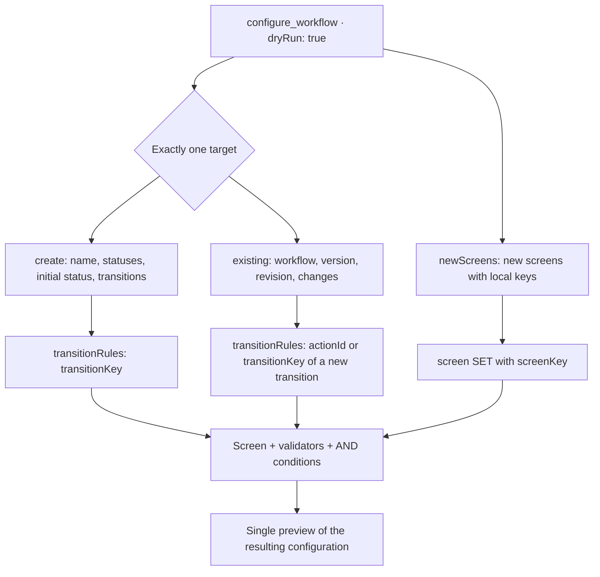
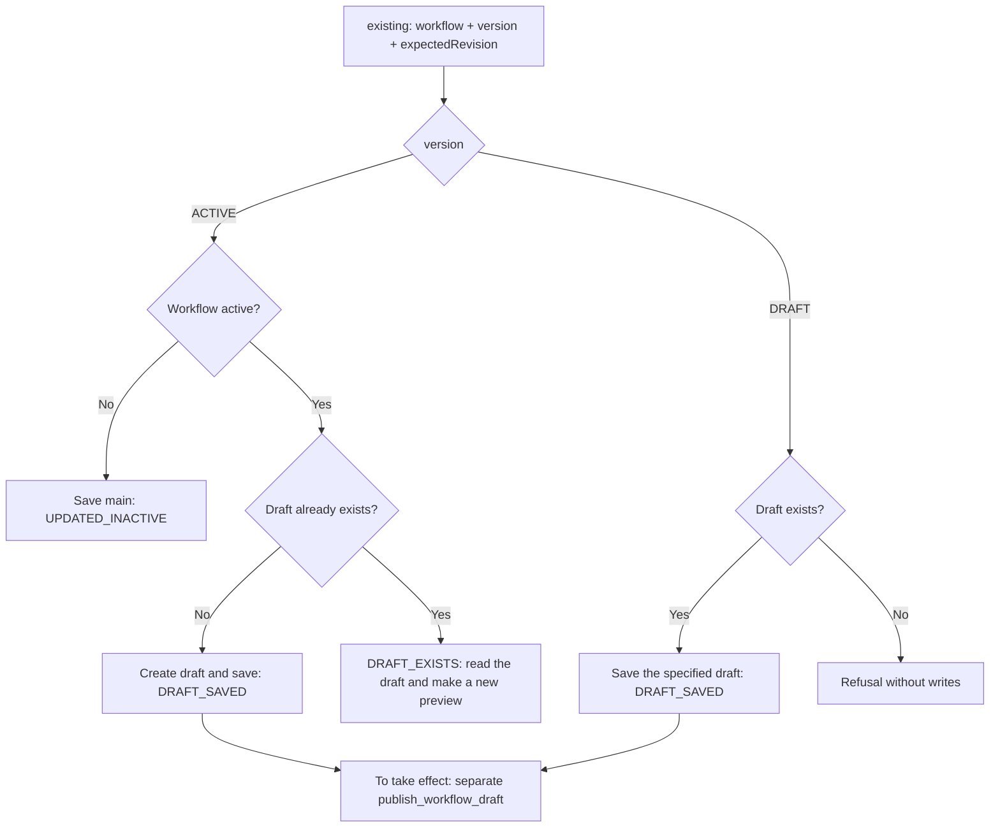
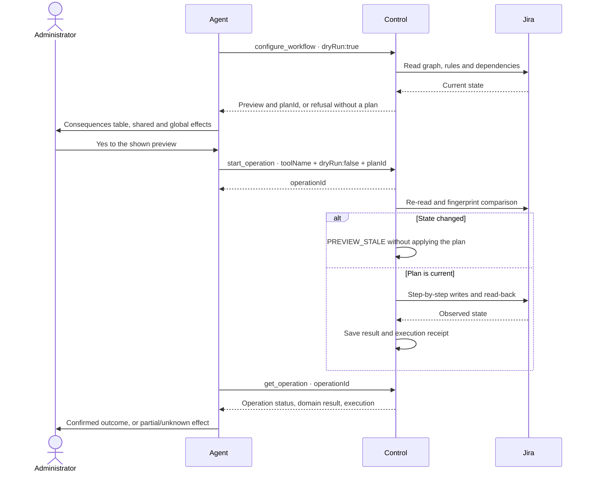

# How configure_workflow works: graph, screens and rules in one plan

## What the tool does

`configure_workflow` configures **one whole workflow within one domain plan**: one preview → one consequences table → one "yes" → one `start_operation`.

It replaces the former `create_workflow`, `configure_workflow_validators`, `configure_workflow_conditions` and the structural editor. It is not a bundle of arbitrary tools and not an atomic Jira transaction.

| Mode | What can be set | How a transition is addressed |
|---|---|---|
| `create` | Graph of a new workflow, existing/new statuses, Resolution, screens, validators and AND conditions | `transitionKey` — the local `key` from `create.transitions` |
| `existing` | Structural edits via `existing.changes`, validators/AND conditions and screen SET/CLEAR, preserving unnamed data | `actionId` of a read, retained transition, or `transitionKey` of a new ADD_TRANSITION in this request; `version` and `expectedRevision` are required |

Exactly one of `create` and `existing`. Assigning to a project and publishing a draft are separate operations with their own previews and confirmations.

## What a request is made of



- `create.transitions[].key` and `newScreens[].key` are references **within the request**, not Jira object IDs.
- One `transitionRules` block per transition; it can combine a screen and several rules. There is no need to create a screen or add each validator as a separate operation.
- A new screen is created with one tab, `Field Tab`; `fieldIds` sets the order of existing orderable fields. One `screenKey` on several transitions creates one screen.
- `screen:"KEEP"` leaves the screen as is, without checking or repairing it. `screen:{action:"SET",...}` requires exactly one reference: `screenId`, `screenName` or `screenKey`. An ambiguous name of an existing screen requires an ID.

## Example: required assignee and closing restricted to a role

A sample configuration: starting requires `assignee`, and only a member of the project role `Developers` can finish. The status and role names below are an example, not a catalog read from your Jira. Before a real call, the role must be confirmed by the user or a lookup, and `<resolution-id>` replaced with an ID from `get_resolutions`.

```json
{
  "dryRun": true,
  "create": {
    "name": "Delivery",
    "statuses": [
      {"name": "Open", "category": "TO_DO"},
      {"name": "Working", "category": "IN_PROGRESS"},
      {"name": "Done", "category": "DONE"}
    ],
    "initialStatus": "Open",
    "transitions": [
      {"key": "start", "name": "Start", "from": "Open", "to": "Working"},
      {
        "key": "finish", "name": "Finish", "from": "Working", "to": "Done",
        "resolution": {"action": "SET", "value": "<resolution-id>"}
      }
    ]
  },
  "newScreens": [
    {"key": "start-form", "name": "Delivery start", "fieldIds": ["assignee"]}
  ],
  "transitionRules": [
    {
      "transitionKey": "start",
      "screen": {"action": "SET", "screenKey": "start-form"},
      "addValidators": [
        {"template": "required_fields", "parameters": {"fieldIds": ["assignee"]}}
      ]
    },
    {
      "transitionKey": "finish",
      "addConditions": {
        "operator": "AND",
        "rules": [
          {"template": "project_role", "parameters": {"roles": ["Developers"]}}
        ]
      }
    }
  ]
}
```

A status with an exact, case-insensitive name match is reused and keeps its category. If the status does not exist, a **global** status is created; a category is required for it. A mismatch between the process meaning and the category must be resolved before confirmation, rather than treating any status without outgoing arrows as DONE.

`initialStatus` sets where an issue starts. The `All` arrow in a diagram is something else: `fromAny:true` without `from`, i.e. one global transition from all statuses, including the target. For "from any to any" you need one such transition per target status, not a set of pairwise arrows.

### Rules: access, data and outcome are different things

| Mechanism | Form | Effect |
|---|---|---|
| Required fields validator | `required_fields`, `parameters.fieldIds` | Blocks the transition without values; does not make the field required across the project |
| Comment validator | `comment_required`, no parameters | Requires a comment and a resulting transition screen; the screen can be created by the same plan |
| Group condition | `group`, `parameters.group` | Access only for a member of an existing Jira group; ScriptRunner not needed |
| Role condition | `project_role`, `parameters.roles`, optional `invert` | Any of the listed roles in the issue's project; `invert:true` — none of them |
| Resolution | `create.transitions[].resolution` | Standard post function for future executions of the transition; does not fix existing issues |

Validators and `project_role` require ScriptRunner installed and enabled in a verified version: currently `9.46.0`. Compatibility of conditions and validators is checked separately. Arbitrary Groovy scripts, classes and arguments cannot be passed.

All added conditions are joined with **AND**. Within one `project_role`, the role list means "at least one", not "all". An existing OR root is rejected when adding conditions: the tool does not rewrite access logic.

Old rules and their order are preserved. For `required_fields`, the fields of all exactly recognized unconditional validators are taken into account; missing fields are added as a separate validator rather than replacing the old one. Equivalent supported rules are not duplicated. A required field missing from the resulting screen produces a warning; for `comment_required`, a missing suitable screen is a refusal.

### Resolution when creating a graph

- Entering DONE from another status, including another DONE, and a global transition into DONE require `SET` with a canonical ID from `get_resolutions`.
- Leaving DONE for non-DONE and a global transition into non-DONE automatically get `CLEAR`.
- Between non-DONE statuses the value is preserved by default. A DONE loop preserves the value or explicitly sets `SET`.
An explicit `CLEAR` is allowed only for non-DONE. In create, `PRESERVE` is the effective preview result, not an input `action` value; structural changes in existing allow an explicit `PRESERVE`.

## What happens to an existing workflow

First read `get_workflow` and, if needed, `get_workflow_validators` and `get_workflow_conditions`: you need the real `actionId`, revision, current rules and consumers. A transition cannot be addressed by its button name alone.

`existing.changes`, if set, contains 1–100 closed objects: `ADD_STATUS`, `REPLACE_STATUS`, `UPDATE_TRANSITION`, `ADD_TRANSITION`, `REMOVE_TRANSITION`, `SET_INITIAL_STATUS`, `UPDATE_METADATA`, `REMOVE_STATUS`. Omitting it keeps rules-only behavior; `null`, an empty array and null elements are rejected. `ADD_STATUS` uses an existing global status; `REMOVE_STATUS` does not delete it and does not cascade-delete transitions. Restrictions on occupied steps and initial/common/conditional/join/split are preserved.

`ADD_TRANSITION.transitionKey` is an optional unique case-sensitive key (1–255 characters, no leading/trailing spaces), allowed only on this operation. `transitionRules` addresses exactly one `actionId` of a retained read transition, or this key. You cannot guess a new actionId, reference a removed transition or repeat a target. The `clientKey` of a new step and `newScreens.key` are independent key spaces.

The structural patcher first modifies a private descriptor, then the root `transitionRules` are applied and the result is checked. A new transition, screen and rule are set in one preview, without an intermediate save/read of the new ID:

```json
{"dryRun":true,"existing":{"workflow":"Delivery","version":"ACTIVE","expectedRevision":"<read-revision>","changes":[{"op":"ADD_TRANSITION","transitionKey":"return","name":"Return","source":{"stepId":3},"targetStepId":1,"resolution":{"action":"CLEAR"}}]},"newScreens":[{"key":"return-form","name":"Delivery return form","fieldIds":["assignee"]}],"transitionRules":[{"transitionKey":"return","screen":{"action":"SET","screenKey":"return-form"},"addValidators":[{"template":"required_fields","parameters":{"fieldIds":["assignee"]}}]}]}
```

Here the stepIds are read from Jira and the target is non-DONE. `newScreens` declares the `key`, and `screenKey` is used only in the reference. Every new screen must be used. An explicit screen SET/CLEAR in both changes and transitionRules for the same target refuses the whole request, even with equal values; KEEP/absence does not conflict.

The final screen/validator check for existing covers added transitions, retained targets of an explicit SET/CLEAR (including no-op), and non-empty validators/conditions requests (including already existing rules). All resulting recognizable validators are checked: `comment_required` without a suitable screen and view="fieldscreen" gives `TRANSITION_SCREEN_MISSING`, required_fields without the field gives a warning, unknown validators are preserved with a "not analyzed" warning. Removed transitions are excluded. KEEP without rules, rename/source/target/resolution-only and UPDATE_METADATA do not widen this scope; an unrelated old defect does not block the edit. Structural-only edits do not require ScriptRunner.




The draft is shared among administrators, not a personal copy. Saving it does not change the active version, projects or issues. Publishing will affect **all** projects and schemes that use the workflow; it is a separate confirmed action. For an inactive workflow, the configuration takes effect after assignment.

LOCAL/GLOBAL transitions support rules and a screen; COMMON supports only a screen, showing all steps that use it; INITIAL supports rules but not a screen. The automatic INITIAL of a new workflow in `create` cannot be addressed.

## From preview to a verified result



The preview shows the resulting restrictions together with the old ones, screens, new global statuses and standalone screens, workflow consumers and warnings. A change to a shared workflow does not become local because the user named one project.

`start_operation` receives only `toolName:"configure_workflow"` and `arguments:{dryRun:false,planId}`; the original graph and rules are not passed again. `planId` proves that a preview exists, **not human approval**. A new request, or an expired or stale preview, requires showing the consequences again and a new "yes".

The fingerprint covers the request and result, main/draft revision, rules, reference data, selected objects, consumers and warnings. The initial replan under locks refuses with `PREVIEW_STALE` before the first write. Between native steps, dependencies are checked taking the operation's own confirmed writes into account: a detected stale state stops the following steps, but screens already created may remain; the FAILED/PARTIAL/UNKNOWN result and the receipt reflect the actual effects. Control's locks do not block the Jira UI or third-party plugins: atomicity, rollback and absence of an external race after the last check are not guaranteed.

### Why COMPLETED is not yet success

The operation is **forward-only**: no rollback, compensation, Audit Undo or automatic retry of mutations. Statuses and screens created before a failure may remain; a screen may be incomplete or unassigned.

`get_operation.execution` stores the steps `STATUS`, `SCREEN`, `WORKFLOW_COPY`, `DRAFT`, `WORKFLOW_SAVE`. For each one, the following are visible separately:

- `writeStatus`: `APPLIED`, `FAILED`, `NOT_ATTEMPTED` or `UNKNOWN`;
- `verification`: `MATCH`, `MISMATCH`, `UNAVAILABLE` or `NOT_CHECKED`;
- the known ID and error. The intent is recorded before the native call, the confirmed result before the read-back.

`APPLIED` does not equal `MATCH`. Only a complete, matching read-back gives a domain `SUCCESS` with result `CREATED`, `UPDATED_INACTIVE` or `DRAFT_SAVED`. A write without a confirmed read-back is `PARTIAL`; a possible effect without confirmation is `UNKNOWN`. `COMPLETED` describes the worker finishing, not the configuration succeeding. If the worker is lost, `BLOCKED` is possible.

On failure, do not declare the rules saved or repeat creation by name. First read `result`, `execution` and the real state through the readers. A lost start response is recovered with the identical `start_operation` with the same plan, or with `get_operation`, not with a new mutation.

After a successful read-back, the result returns `transitionKey → actionId` in `transitions`, `clientKey → stepId` for added steps, and `newScreens.key → screenId` in `objects`. Planned preview IDs are not saved IDs and are not valid input actionIds for the same request. On FAILED/PARTIAL/UNKNOWN, known actual IDs are read from the receipt; planned transitions/diff are not presented as success.

### Cutover of the old editor

`edit_workflow` has been removed from the catalog, dispatch and start route with no alias. An old unused preview cannot be passed to configure: read Jira, get a new preview and a new confirmation. Historical terminal results are read via `get_operation` with the former name/content; starting the removed tool again does not recover the response. Accepted operations are not replayed/renamed, and AO is not rewritten. Before installing the cutover, wait for a terminal status of all known accepted operations; QUEUED/RUNNING forbids the upgrade. An abnormal interruption is handled by the existing abandoned-operation recovery (including BLOCKED), not as an automatic success; possible effects are reconciled by operationId/Jira.


## Latest change: flat argument schema

In `1.2.2`, the `configure_workflow` MCP input schema was simplified so that clients can display nested arguments: `$defs/$ref`, `oneOf/anyOf/allOf/not`, conditional combinators and `pattern` were removed. Objects remain closed (`additionalProperties:false`); types, enums and simple limits are kept.

This is **not** a change to the request format and not a relaxation of server rules. Mutual exclusions are now described on the properties and checked by the server: exactly one target, a valid transition address, exactly one screen reference, only the parameters of the given template, `SET` with `value`, `CLEAR` without it. An invalid request is rejected with no plan and no writes to Jira; the message names the offending field. The flat client schema by itself does not prove that a combination of fields is allowed.

Do not confuse the two "schemas": the **MCP argument JSON Schema** helps the model build the call; the **Jira Workflow Scheme** assigns workflows to issue types. `configure_workflow` does not assign a Workflow Scheme to a project.

## Limits and sources

| Part of the request | Limit |
|---|---|
| Statuses of a new graph | 2–30 |
| Transitions of a new graph / `transitionRules` blocks | Up to 100 each |
| New screens | Up to 10 |
| Fields of a screen / of one validator | Up to 50 |
| Validators / conditions per transition in a request | Up to 10 each |
| Roles of one condition | Up to 20 |

The execution receipt is stored in the existing `JournalProgress` in a lossless representation of up to 32 KiB; this is not a limit on the expanded `get_operation.execution`. Exceeding the limits is rejected before any write; data is not truncated.

- Exact contract and additional bounds: [TOOLS.md](../../TOOLS.md#configure_workflow).
- Catalog and flat schema: [`workflow-tools.json`](../../src/main/resources/llm/workflow-tools.json).
- General MCP route: [MCP-how-it-works.md](MCP-how-it-works.md).
- General background operations mechanism: [Operations-how-it-works.md](Operations-how-it-works.md). For `configure_workflow`, the forward-only mode described here applies.
