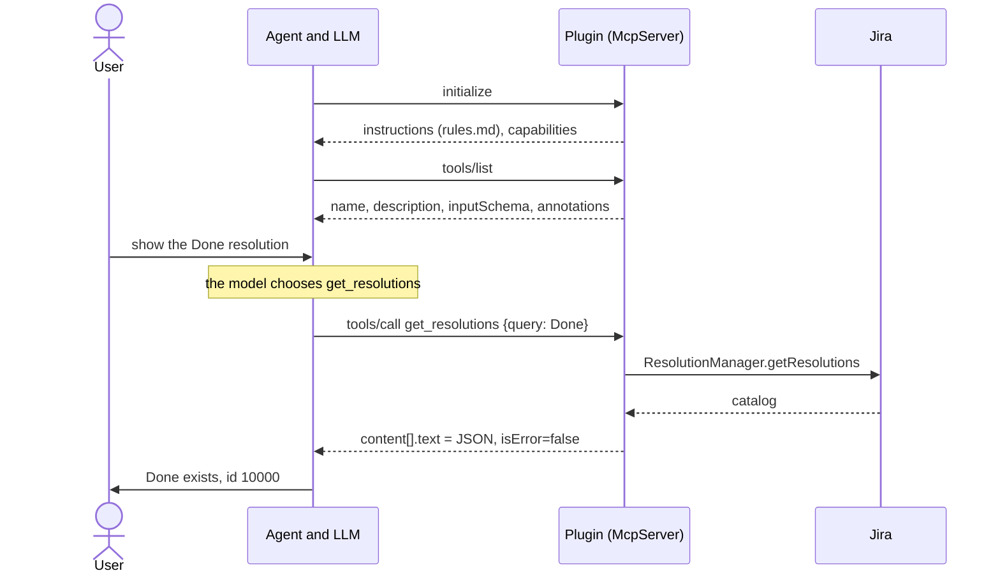
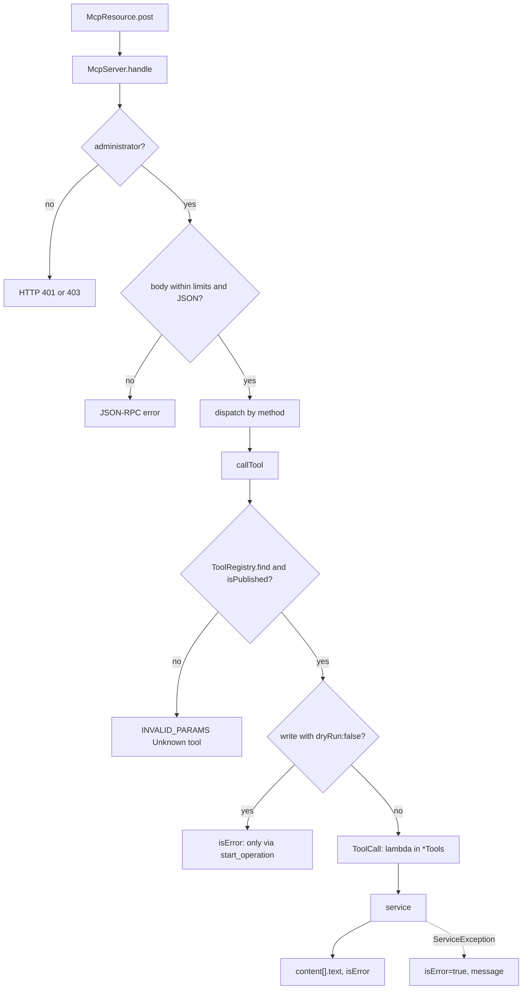

# How MCP works: from the user's phrase to Java code

## In short

- The plugin is itself the MCP server: one `POST /rest/control/1.0/mcp` with JSON-RPC inside. There is no separate SDK and no separate process.
- **The model decides which tool to call.** There is no place in Java where the phrase "create a Done resolution" turns into `get_resolutions` or `create_resolution`. The plugin influences the choice only through what it gives the model: the tool catalog, their `description`, argument schemas, general rules and response texts.
- Everything the model calls, the plugin executes with the rights of the Jira user whose token the client uses. A non-administrator gets nothing.
- Reads respond immediately. Writes go only through a preview and `start_operation`: [Operations-how-it-works.md](Operations-how-it-works.md).
- How to create or configure a workflow with screens and rules in one plan: [Configure-workflow-how-it-works.md](Configure-workflow-how-it-works.md).

## Participants

| Who | Where it lives | What it decides | What it cannot do |
|---|---|---|---|
| User | chat | what they want; answers "yes" to the shown plan | see `planId`: it is an internal identifier, the rules forbid the model to show it |
| MCP client (agent) | on the user's machine (omp, Claude Code, Cursor) | connects, stores the token, runs the "model → tool call → response" loop | change the plugin's responses |
| LLM | at the model provider | **choice of tool and arguments**, the text of questions to the user | access Jira: it only asks the client to call a tool |
| Plugin: `McpResource` → `McpServer` → `ToolCall` (from `*Tools`) → service | inside Jira | rights, argument parsing, calculation, writing, state checks | understand the user's intent |
| Jira | server | stores data; creates and changes through its managers | |

Connecting a client (address, `Authorization` header) is described in the [README](../../README.md#connecting-a-client).

## What MCP is in this plugin

Transport: HTTP `POST`, JSON body and response. `McpResource` takes the body as a string and passes it to `McpServer.handle`, so a bad body becomes a JSON-RPC error rather than a Jersey error. A message without a response (notification) gets `202` with no body. `GET` and `DELETE` are not supported (405). The server is stateless: no session id, no streams, the response is always plain JSON.

| JSON-RPC method | What `McpServer` returns |
|---|---|
| `initialize` | protocol version (the client's, if known: `2025-06-18`, `2025-03-26`, `2024-11-05`; otherwise the newest), `capabilities.tools`, name `jira-control`, plugin version and `instructions` (the text of `llm/rules.md`) |
| `tools/list` | all published tools: `name`, `description`, `inputSchema`, `annotations` |
| `tools/call` | the tool result (see below) |
| `ping`, `notifications/*` | an empty response or nothing |

Other methods: JSON-RPC error `METHOD_NOT_FOUND`. An array of messages is also allowed (batch, at most 20).

**Who can call.** The first line of `McpServer.handle` is `AdministratorGuard.requireAdministrator()`: a logged-in user with the global `ADMINISTER` permission is required. An anonymous user gets HTTP 401, a non-administrator 403 (`ServiceExceptionMapper`): this is an HTTP response, not JSON-RPC. The same guard is repeated by the services and `OperationRunner`: the background thread also runs as the administrator.

**`tools/call` response format.** `{"content":[{"type":"text","text":"<result JSON>"}],"isError":false}`. The model reads the JSON from `text`.

| Situation | What the client gets |
|---|---|
| Success | `isError:false` |
| Write tool, response contains `errorCode` or `status` `FAILED`, `PARTIALLY_ASSIGNED`, `PARTIALLY_CHANGED` (also inside `results[]`, `fields[]`) | `isError:true`, text with the full JSON, diagnostics preserved |
| `ServiceException` (bad arguments, `Unknown argument`, "busy") | `isError:true`, the message text |
| Any other error | `isError:true`, generic text "Jira failed…", details only in the Jira log |
| `dryRun:false` directly on a write tool | `isError:true`: "Apply confirmed previews through start_operation" |
| Read result longer than 500,000 characters | `isError:true` asking to narrow the request; no truncation |
| Unknown tool, no `name`, `arguments` not an object | JSON-RPC error `INVALID_PARAMS` |

A request body larger than 1,000,000 characters is an `INVALID_REQUEST` error. Limits live in `McpLimits`. Results of `start_operation`, `get_operation` and writes are not cut by the limit: having lost the result, the caller would not know whether the write happened. A successful `start_operation` and `get_operation` response always comes with `isError:false`, even if the operation itself is `FAILED`: it is the operation receipt. If the call itself was refused (bad arguments, queue busy, someone else's operation), that is a `ServiceException`, and the response comes with `isError:true`.

## How the agent writes

What the model sees about the plugin:

| What | Where from | Why the model needs it |
|---|---|---|
| `instructions` | `llm/rules.md` via `ToolCatalog.instructions()` in the `initialize` response | general rules: preview → consequences table → one "yes" → `start_operation`; what to do on refusal |
| `name` | `llm/*-tools.json` | call identifier |
| `description` | same | when to call, what to call before and after, which values are allowed |
| `inputSchema` | the `input_schema` field in the JSON, the plugin renames it for MCP | argument shape |
| `annotations` | same | `title`, `readOnlyHint`, `destructiveHint`, `idempotentHint`, `openWorldHint`; the client decides what to ask about |
| tool responses | services | `errorCode`, `message`, `suggestions`: how to fix the request |

How a phrase becomes a call:

1. On connecting, the client does `initialize` and `tools/list` and gives the model the list and the rules.
2. The model matches the user's words against the descriptions and chooses a tool and arguments.
3. The client sends `tools/call`, returns the response to the model, and the loop repeats.

Example: the order "first `get_resolutions`, and only if no value fits, `create_resolution`" is enforced not by Java but by the `description` of the `create_resolution` tool ("Call get_resolutions first…", `llm/resolution-tools.json`). To change the model's behavior, edit `description`, `input_schema` or `rules.md`, not the calling code. The schema is strict (`additionalProperties:false`), and the lambdas in `*Tools` additionally reject unknown arguments (`ToolArguments.allowOnly` or strict parsing into a DTO via `ToolArguments.parse`).

## How a call finds the code

1. `McpResource.post` → `McpServer.handle`: guard, limits, JSON parsing.
2. `respondTo` → `dispatch` by `method` → for `tools/call`, `callTool`.
3. `ToolRegistry.find(name)` returns a `ToolCall`; `ToolCatalog.isPublished(name)` is also required: the tool is in the JSON catalog. If either is missing — "Unknown tool".
4. The lambda in `*Tools` (for example `ResolutionTools`, `WorkflowTools`) checks the arguments (`ToolArguments.allowOnly`, `text`, `optionalText`, `optionalInt`) or turns them into a DTO (`ToolArguments.parse`).
5. The service is called (`ResolutionService.create`…) — the same implementation the REST adapters call. The result is a DTO; `McpServer` serializes it into `text`.

**Where they are registered.** Each area provides a `ToolProvider` bean (`tools()`: name → `ToolCall`). `ToolRegistry` collects them all in its constructor; two providers with the same name stop startup. The catalog for the model is the `llm/*-tools.json` files, whose list is hardcoded in `ToolCatalog` (the `FILES` field). The link between "name for the model" and "code" rests only on one name string in two places: the JSON and `*Tools`. A new tool without an entry in the JSON is invisible to the model and cannot be called.

The journal's internal tools (`create_change_session`, `cancel_operation`, `rollback_changes` and others) are registered in `ChangeTools` but are not in the catalog, so they are not available via MCP. Only `start_operation` and `get_operation` are published (`llm/rollback-tools.json`).

## Reads and writes

- **Read** (`readOnlyHint:true`, including `get_operation`): responds immediately, changes nothing. These are `get_*`, `list_*`, `plan_field_screens` and the like.
- **Write tool** (`readOnlyHint:false`, except the journal file; `ToolCatalog.isDomainMutation`): via MCP it can be called only with `dryRun:true`, i.e. as a preview. Writing goes through `start_operation`, see [Operations-how-it-works.md](Operations-how-it-works.md).

## Diagrams

The user asks to show resolutions, the agent reads the catalog (a read, no write):

Routing inside the plugin:

## Where to look in the code

| Question | Class / file |
|---|---|
| Which URL and what happens to the body | `McpResource` |
| Which MCP methods, how the response is built, `isError` | `McpServer` (`dispatch`, `callTool`, `toolResult`, `domainFailed`) |
| Who can call | `AdministratorGuard`, `ServiceExceptionMapper` (HTTP codes) |
| Request, batch and result sizes | `McpLimits` |
| What the model sees | `ToolCatalog`, `src/main/resources/llm/*-tools.json`, `llm/rules.md` |
| Which tools are published, which count as writes | `ToolCatalog.isPublished`, `isDomainMutation` |
| Tool name → code | `ToolRegistry`, `ToolProvider`, `ToolCall` |
| Area tools | `ResolutionTools`, `WorkflowTools`, `ScreenTools`, `CustomFieldTools`, `ProjectTools`, `IssueTypeTools`, `FieldConfigurationTools`, `LookupTools` |
| Argument checking and parsing | `ToolArguments` |
| `start_operation`, `get_operation` | `ChangeTools`, `OperationRunner`, `ChangeJournal` |
| Client rules for the model | `rules.md`; tool details — [TOOLS.md](../../TOOLS.md) |
| Protocol tests | `McpServerTest`, `ToolCatalogTest` |

Next: how writing works — [Operations-how-it-works.md](Operations-how-it-works.md).
