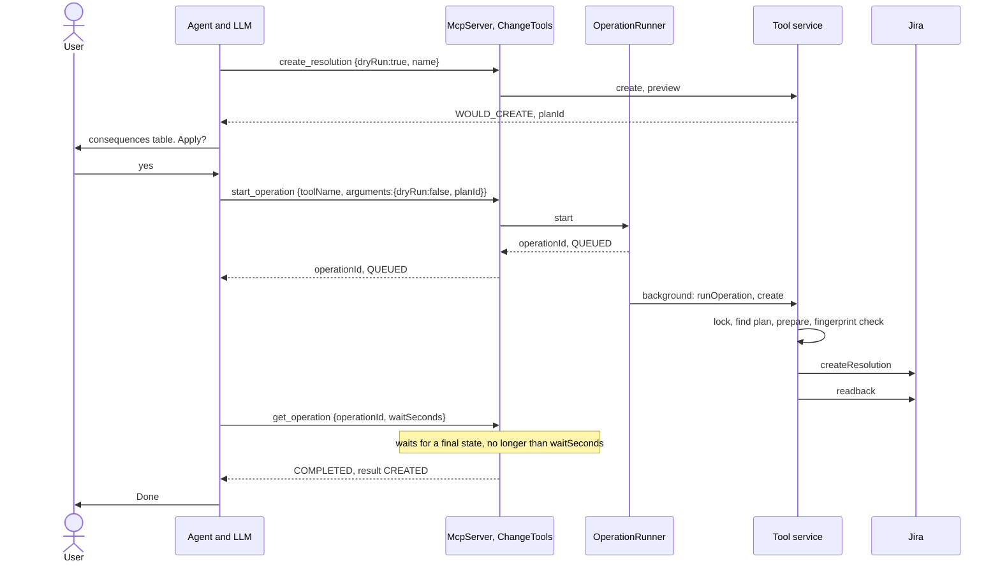
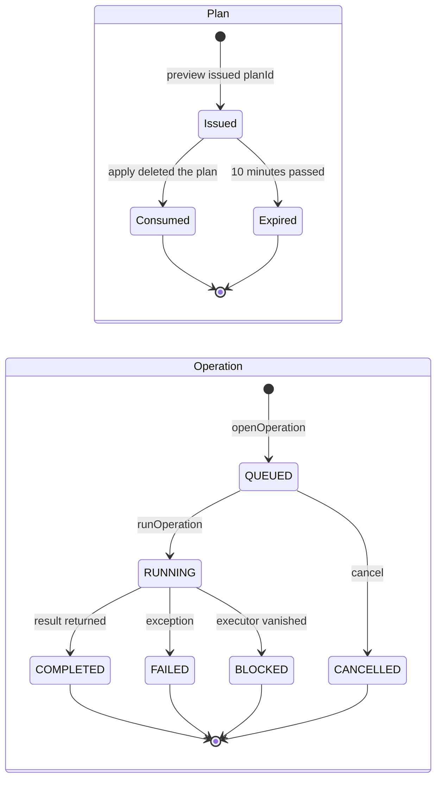
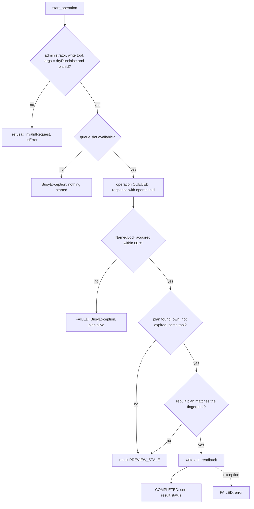

# How writes work: preview → planId → start_operation → get_operation

## In short

- Every change to Jira takes two model calls and one human "yes": **preview** (`dryRun:true`) → showing the consequences and confirmation → **apply** through `start_operation` with `planId`.
- The preview writes nothing, but it stores the plan and returns a single-use `planId`. Apply runs in the background and checks the Jira state against the plan **again**.
- `start_operation` only queues the operation and immediately returns `operationId`. The outcome is read through `get_operation`.
- Operation status `COMPLETED` means "the code ran to the end", not "Jira was changed". The domain outcome is in `result`.
- How a tool reaches the model and the code at all: [MCP-how-it-works.md](MCP-how-it-works.md).
- A domain example with a graph, screens, rules and forward-only execution: [Configure-workflow-how-it-works.md](Configure-workflow-how-it-works.md).

## Why two steps

| Threat | How it is closed |
|---|---|
| The model writes to Jira on its own | `McpServer.callTool` answers `isError` to `dryRun:false` on a write tool: "Apply confirmed previews through start_operation" |
| The human did not see what exactly will change | the model must (rules in `rules.md`) show a consequences table and get a "yes"; the plugin itself does not ask the human |
| Jira changed between the preview and the "yes" | on apply the plan is rebuilt and compared by fingerprint; a mismatch gives `PREVIEW_STALE` |
| Someone else's, expired or reused plan | the plan is bound to the administrator and the tool, lives 10 minutes, and is deleted after apply |
| Two applies at the same time | a `NamedLock` lock around the write |

`planId` only proves that such a preview exists. The plugin does not know whether a human approved it.

## Steps and invariants

### 1. Preview (`dryRun:true`)

- The service computes the consequences and **writes nothing**. Mode rules: `dryRun` is given explicitly; a preview has no `planId` (`validateMode` in `ResolutionServiceImpl`).
- If changes are needed, the service stores a plan: `ActionPlanStore.issue(operation, administrator, request, fingerprint)`. A plan is the normalized request (`ActionPlanCodec.request`) and the fingerprint.
- **Fingerprint** (`ActionPlanCodec.fingerprint`): SHA-256 of the canonical JSON of an object the service chooses itself. It must include everything the write depends on. For a Resolution this is the desired value and a snapshot of the whole catalog (id → name, description): one more Resolution appears, and the fingerprint is different.
- **Lifetime**: `ActionPlanStore.TTL_MILLIS` = 10 minutes (the cache is replicated across the cluster). At most 100 open plans per administrator per node (otherwise `BusyException`); request and fingerprint size up to 1,000,000 characters.
- A preview with no changes (`EXISTS`, `FAILED`, `UNCHANGED`) issues no plan.

For the layout of one screen, the plan unit is the whole `edit_screen_layout` request: `remove[]` → `add[]` → `moves[]`. Do not issue separate add/move/remove plans for one screen: the first apply would make the others stale. The fingerprint covers the full screen and the contexts of the custom fields being added; one lock, one write pass, a readback of the whole screen, one Audit row. The multi-screen `add_field_to_screens`/`remove_field_from_screens` do not replace this route. Historical `move_screen_fields` operations are readable, but that tool is no longer published. There is no automatic layout undo; RESTORED/PARTIAL/UNKNOWN describe the observed result, not an atomic transaction.

### 2. Human confirmation

This is dialogue, not code. The model shows the consequences table once and asks for a "yes"; one "yes" covers the shown plan. A new or changed request means a new preview and a new "yes".

### 3. `start_operation`

Input: `{toolName, arguments:{dryRun:false, planId}, sessionId?, changeSetId?}`. `OperationRunner.start` (under `synchronized`) checks, in order:

1. the caller is an administrator;
2. `toolName` is a write tool (`ToolCatalog.isDomainMutation`) and is in `ToolRegistry`;
3. `arguments` contains exactly `dryRun:false` and a non-empty `planId`, nothing else;
4. `sessionId` and `changeSetId` are either both given or both omitted (usually omitted: the plugin creates them itself);
5. there is room in the queue: 2 worker threads and 32 queued, 34 slots in total, otherwise `BusyException`.

Then `ChangeJournal.openOperation` records the operation in state `QUEUED`, the task goes to a background thread, and the client immediately gets an operation snapshot with `operationId`, `sessionId`, `changeSetId`. **`start_operation` does not check the plan owner, expiry or "already used"**: the service does that during execution (see below). So someone else's, expired or used plan yields a `COMPLETED` operation with `result.errorCode = PREVIEW_STALE`, not a `start_operation` refusal.

### 4. Execution (background thread)

`OperationRunner` logs into Jira as the administrator and calls `ChangeJournal.runOperation(id, …)`:

1. under the operation lock, `QUEUED` → `RUNNING` (a repeated start is rejected: "already started");
2. the tool's `ToolCall` is invoked with the same `{dryRun:false, planId}`, i.e. the same service that computed the preview;
3. the service: `ChangeJournal.execute` → `NamedLock.run` (waits for the lock up to 60 s, otherwise `BusyException`, nothing changed) → `apply`:
   - `ActionPlanStore.find(operation, administrator, planId)`: no plan, or it belongs to someone else, has expired or is from another tool — `PREVIEW_STALE`;
   - `prepare` again from the stored request (`ActionPlanCodec.mode`), check of status and fingerprint — a mismatch gives `PREVIEW_STALE`;
   - `ChangeJournal.prepare` before the write, the write to Jira, verification of the result by reading (for a Resolution, the confirmed id), `ChangeJournal.applied`, `checkpoint`;
   - `finally`: `ActionPlanStore.remove(planId)`: the plan is single-use, even if apply failed or turned out stale. Exception: a busy lock — `apply` was never reached, the plan stays alive until it expires;
4. the result is serialized and the operation gets `COMPLETED` with `result`; an exception gives `FAILED` (or `CANCELLED`) with `error`, after which the journal tries to compensate the steps already written (`compensate`). A result larger than 4 MiB also leads to `FAILED`;
5. in `finally` the runner writes the apply journal row and releases the slot.

### 5. `get_operation(operationId, waitSeconds)`

`waitSeconds` from 0 to 20, default 20. The server waits itself inside `ChangeJournal.getOperation`: it re-reads the state after 0.5 s, then 1 s, then every 2 s, and answers as soon as the operation is no longer "pending" or time runs out. At most 8 calls wait at the same time per node; the ninth immediately gets the current state. Only its owner can see an operation: for someone else's — `AccessException`, a response with `isError:true`.

| State | Final? | Meaning |
|---|---|---|
| `QUEUED`, `RUNNING` | no | call `get_operation` again right away |
| `CANCEL_REQUESTED` | no | the code treats it as pending, but never sets it (cancellation is for now the `cancelRequested` flag; see "Unclear in the code") |
| `COMPLETED` | yes | the code finished; **the domain outcome is in `result`** |
| `FAILED` | yes | exception; `error`, `result` empty, some writes may remain |
| `CANCELLED` | yes | cancelled before or during start (`cancel_operation` is not published via MCP) |
| `BLOCKED` | yes | the executor died without a result (watchdog after one hour); reconciliation needed |
| `ROLLED_BACK`, `PARTIAL` | yes | the result of rolling back the operation (`BLOCKED` occurs there too) |

`COMPLETED` ≠ success: `result.status` can be `CREATED`, but also `FAILED` with `errorCode` (`PREVIEW_STALE`, `JIRA_ERROR`…), `EXISTS`, `UNCHANGED`. That is why a successfully read operation comes with `isError:false` whatever its outcome: it is a receipt, look at the operation `status` and `result`. `isError:true` means the read itself failed.

### 6. Apply journal and rollback

In the runner's `finally`, `recordApply` writes **one row per operation** (key `APPLY:<operationId>`) to the apply journal; a write error changes nothing in the operation. What the row contains and how to read it: [../audit/Audit-how-it-works.md](../audit/Audit-how-it-works.md). Rollback (`rollback_changes`, preview and confirmation by `planId`, `ChangeJournal.rollback`) is not published via MCP; it is described in Audit and [TOOLS.md](../../TOOLS.md#general-rules).

## Partial result

A write to Jira is not atomic: several objects at once and several API calls. Therefore:

- final statuses like `PARTIALLY_CHANGED`, `PARTIALLY_ASSIGNED`, `PARTIAL` and the `partialEffect` field (`applied`, `compensated`, `leftBehind`, `notStarted` for `set_field_required`) say that part of the changes **remained**;
- `FAILED` and `JIRA_ERROR` do not prove that nothing was written either;
- **never repeat apply blindly**: the plan is already consumed, a repeat with the same `planId` returns `PREVIEW_STALE`, and a new preview will show the already changed state. The right thing is to read `result`, report what remained, and build a new preview with a new confirmation.

The exact statuses of every tool are in [TOOLS.md](../../TOOLS.md).

## Diagrams

Full cycle:



Lifecycle of a plan and an operation:



What is checked and where refusals happen:



## End-to-end example: `create_resolution`

The id values are illustrative, responses are shortened. The `tools/call` wrapper is omitted; `arguments` and the contents of `content[].text` are shown.

**Step 0. Read.** `get_resolutions {"query":"Done"}` → `[]`.

**Step 1. Preview.**

```json
{"dryRun":true,"name":"Done","description":"Work is complete"}
```

```json
{"status":"WOULD_CREATE","dryRun":true,
 "resolution":{"name":"Done","description":"Work is complete"},
 "message":"Resolution is global for all Jira, not just this workflow. ... Show this preview and obtain confirmation before applying planId.",
 "planId":"plan-demo-0001","planExpiresAt":1790000600000}
```

**Step 2.** The agent shows the table ("create the global Resolution Done, affects all projects") and asks. The user: "yes".

**Step 3. `start_operation`.**

```json
{"toolName":"create_resolution","arguments":{"dryRun":false,"planId":"plan-demo-0001"}}
```

```json
{"operationId":"op-demo-0001","sessionId":"ses-demo-0001","changeSetId":"cs-demo-0001",
 "operation":"create_resolution","status":"QUEUED","cancelRequested":false,"steps":[]}
```

**Step 4. `get_operation`.**

```json
{"operationId":"op-demo-0001","waitSeconds":20}
```

```json
{"operationId":"op-demo-0001","operation":"create_resolution","status":"COMPLETED",
 "result":{"status":"CREATED","dryRun":false,
           "resolution":{"id":"10500","name":"Done","description":"Work is complete"},
           "report":{"created":[{"kind":"RESOLUTION","id":"10500","name":"Done"}]}},
 "steps":[{"kind":"resolution.created","resource":"resolution-name:Done","status":"APPLIED"}]}
```

**Variant: another Resolution was created in Jira in the meantime** (the fingerprint changed). The operation is still `COMPLETED`, but:

```json
{"status":"COMPLETED",
 "result":{"status":"FAILED","dryRun":false,"errorCode":"PREVIEW_STALE",
           "message":"Preview is missing, expired, consumed, belongs to another administrator, or the Resolution catalog changed. Build a fresh preview and obtain confirmation."}}
```

The model must show a new preview and ask again.

## Where to look in the code

| Step | Class and method |
|---|---|
| Refusal of a direct `dryRun:false` | `McpServer.callTool` |
| Preview, issuing the plan | `ResolutionServiceImpl.create` → `prepare`, `ActionPlanStore.issue` |
| Fingerprint, stored request | `ActionPlanCodec.fingerprint`, `request`, `mode` |
| Plan: expiry, owner, limits | `ActionPlanStore` (`TTL_MILLIS`, `find`, `peekRequest`, `remove`) |
| `start_operation`, argument checks | `ChangeTools` (`start_operation` lambda) → `OperationRunner.start` |
| Queue, background thread, slot | `OperationRunner` (`executor`, `slots`) |
| Operation states, owner | `ChangeJournal` (`openOperation`, `runOperation`, `complete`, `failOperation`, `ownedOperation`) |
| Write lock | `NamedLock.run` |
| Re-check and write | `ResolutionServiceImpl.apply`; journal steps `ChangeJournal.prepare`, `applied`, `checkpoint` |
| `get_operation`, waiting | `ChangeTools` (`get_operation` lambda) → `ChangeJournal.getOperation(id, actor, waitSeconds)` |
| Apply journal row | `OperationRunner.recordApply`, `ApplyJournal` |
| Domain error flag in the MCP response | `McpServer.domainFailed` |

## Common mistakes when adding a write tool

1. **Writing on `dryRun:true` or accepting `dryRun:false` with request data.** A preview only computes and issues a plan; apply accepts only `dryRun:false` and `planId` (`validateMode`), and `start_operation` rejects any other arguments.
2. **Forgetting `readOnlyHint:false` in `llm/*-tools.json` or the registration in `ToolProvider`.** Without the first, `start_operation` refuses ("not a mutation tool"); without the second, the model will not see the tool. `dryRun` in the schema has `enum:[true]`.
3. **A fingerprint narrower than what the write depends on.** On apply the state is re-read and compared only with what went into the fingerprint; anything left out can change between the preview and the write unnoticed.
4. **Writing around `ChangeJournal.execute`, `NamedLock.run` and `ActionPlanStore.find`.** Without them there is no plan owner and expiry, no protection against two writers, no journal row, no `prepare`/`applied` steps and no compensation. The operation name in `issue` and `find` must match the tool name.
5. **Not deleting the plan after apply, and issuing a plan for an empty change.** Single use relies on `plans.remove` in `finally`; a preview with no changes gets no plan.
6. **A result larger than 4 MiB, or an exception instead of a domain response.** The operation becomes `FAILED`; domain refusals (`PREVIEW_STALE`, `VALIDATION_ERROR`) return a DTO with `errorCode` so the model can fix them.

## Unclear in the code

- `CANCEL_REQUESTED` appears in the "should we wait" check and in tool descriptions, but is never set as an operation state: cancellation is stored as the `cancelRequested` flag.
- There is no single shared place for the plan check: each service calls `ActionPlanStore.find` itself. `ResolutionServiceImpl` is described above; for the others the order of steps may differ, see their `apply`.

Back: [MCP-how-it-works.md](MCP-how-it-works.md).
